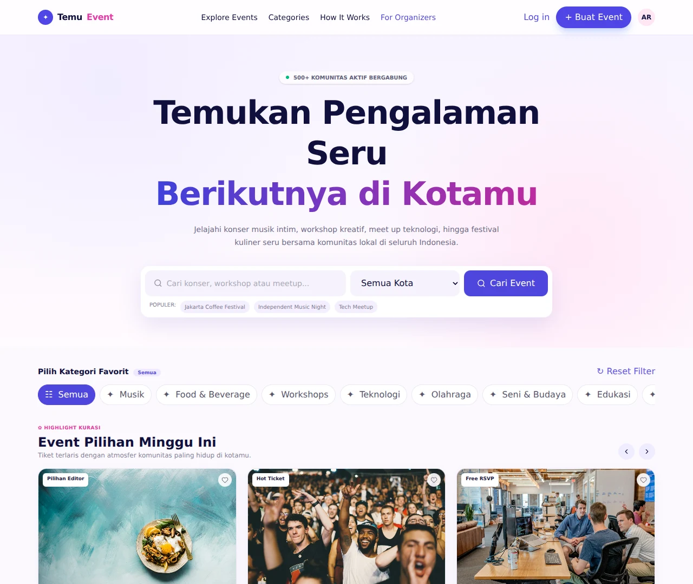
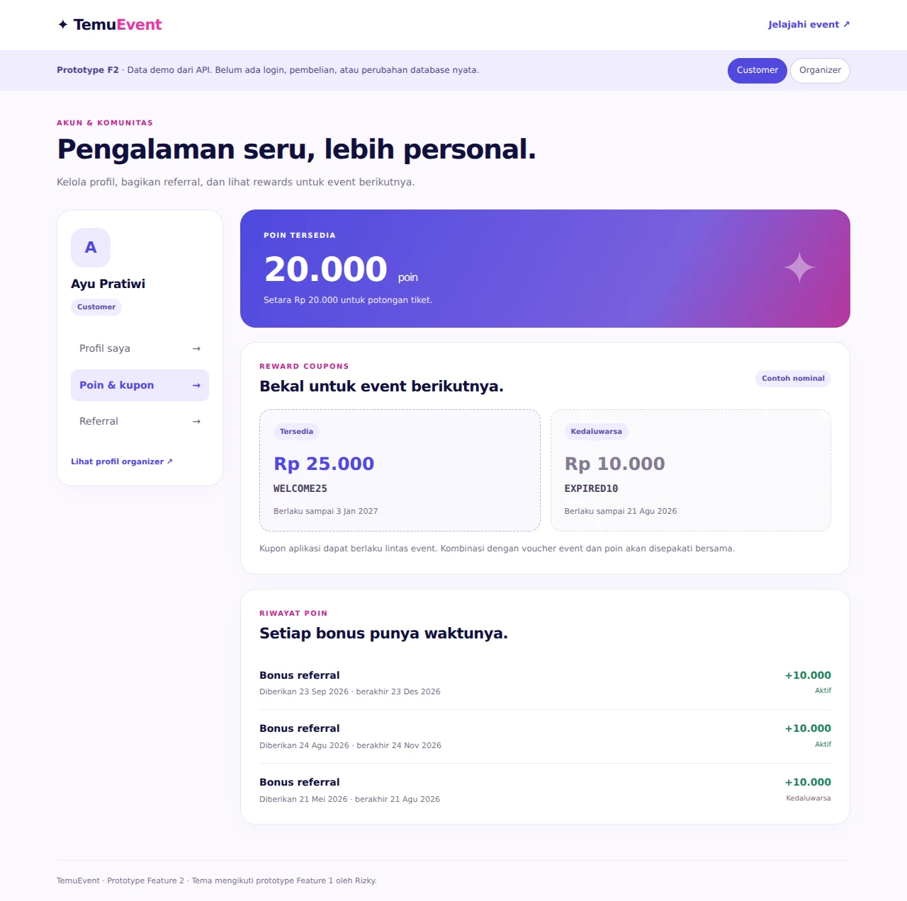

# TemuEvent — Event Management Platform

- [Shared project record](docs/shared/README.md)
- [TemuEvent social-preview image](docs/branding/temuevent-social-preview.png)
- [Shared database/backend technical reference](docs/shared/technical-reference.md)
- [Shared UX reference and working defaults](docs/shared/ux-reference.md)
- [Feature 1 source](https://github.com/wilisail/event-management-platform-pwdk/tree/feature-1) · [Feature 2 source and run instructions](https://github.com/wilisail/event-management-platform-pwdk/tree/feature-2/feature-2)

## UI previews

UI snapshots captured on 18 October 2026. Open [all preview screens](docs/previews/README.md) for event details and checkout. These images are static previews; interactive use follows the linked run instructions. GitHub Actions and hosting are not configured by this update.

### Feature 1 — discovery

Rizky's TemuEvent visual baseline, accepted through [PR #1](https://github.com/wilisail/event-management-platform-pwdk/pull/1).

### Feature 2 — account and rewards

Wili's separately runnable preview, following the same visual direction. Account identities and rewards are demo data; production authentication and persistence are pending. Source: [draft PR #2](https://github.com/wilisail/event-management-platform-pwdk/pull/2).

