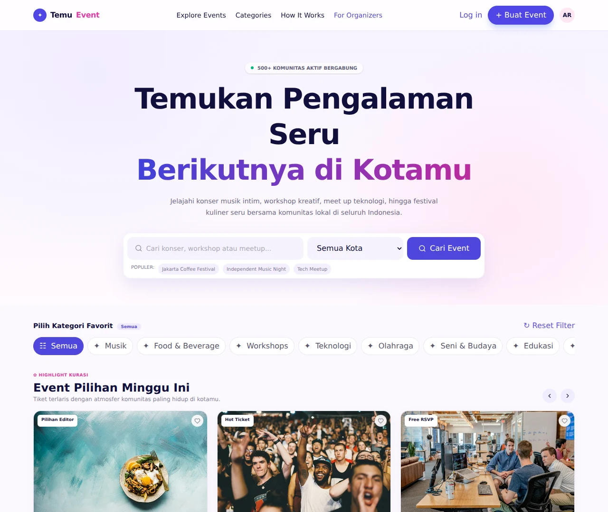
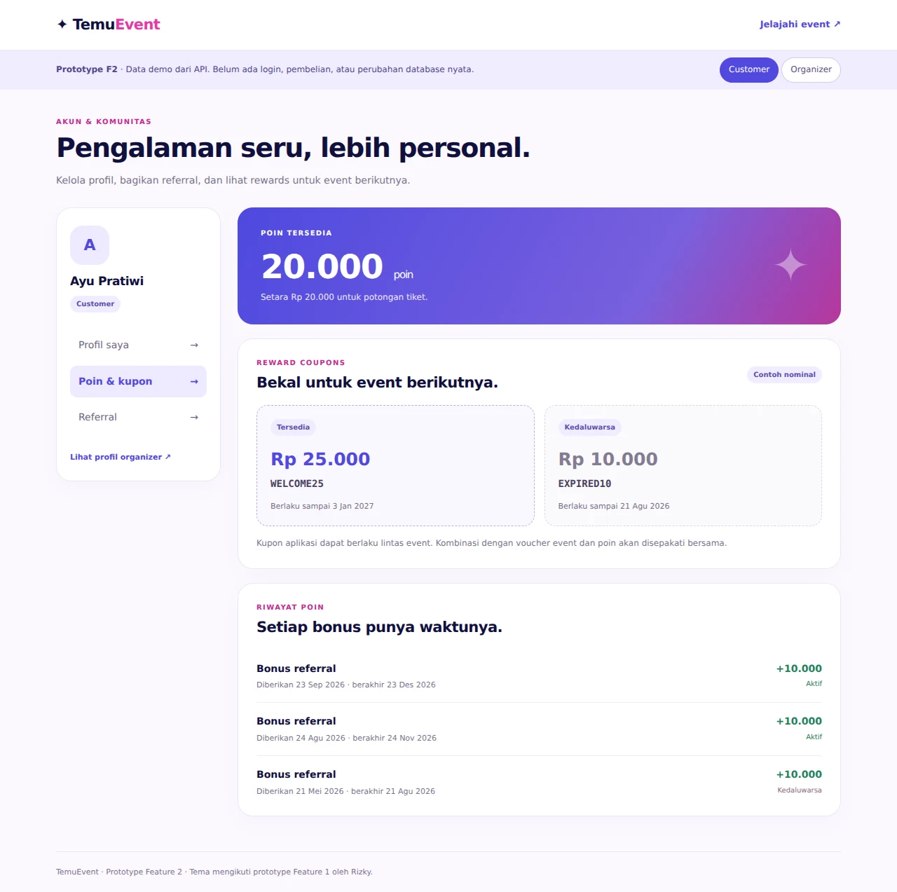

# TemuEvent — Event Management Platform

[Live website](https://temuevent-combined-qa-andor2.vercel.app/?_vercel_share=qmo9VMK1f04D1Xoc4dYkmNAermfwHhcQ)

- [Submission release 17 November](docs/shared/submission-release-2026-11-17.md) — accepted owner review, released source and video handoff.
- [Current UX acceptance and remaining test steps](docs/shared/current-ux-acceptance.md) — current QA behavior, owner decisions and live versus mock dependencies. The UI snapshots below are dated historical previews.
- [QA release verification](docs/shared/f2-temporary-qa-release-2026-11-15.md) · [Ordered evaluation and UX tour](docs/shared/f2-qa-evaluation-tour-2026-11-15.md) — temporary F2 saved purchase/proof journey, live on combined QA.
- [16 November owner UX review](docs/shared/ux-owner-feedback-2026-11-16.md) — accepted screen journey, account/reward reconciliation and bounded UX refinements; full PRD assessment remains separate.
- [Shared project record](docs/shared/README.md)
- [TemuEvent UI reference](docs/ui/README.md) · [Social-preview image](docs/ui/temuevent-social-preview.png)
- [Shared database/backend technical reference](docs/shared/technical-reference.md)
- [Database setup and current status](docs/shared/database-setup.md)
- [Shared UX reference and working defaults](docs/shared/ux-reference.md)
- [Feature 1 source](https://github.com/wilisail/event-management-platform-pwdk/tree/feature-1) · [Feature 2 source and run instructions](https://github.com/wilisail/event-management-platform-pwdk/tree/feature-2/feature-2)

## UI previews

UI snapshots captured on 18 October 2026. Open [all preview screens](docs/previews/README.md) for event details and checkout. These images are static previews; interactive use follows the linked run instructions. GitHub Actions and hosting are not configured by this update.

### Feature 1 — discovery

Rizky's TemuEvent visual baseline, accepted through [PR #1](https://github.com/wilisail/event-management-platform-pwdk/pull/1).

### Feature 2 — account and rewards

Wili's separately runnable preview, following the same visual direction. Account identities and rewards are demo data; production authentication and persistence are pending. Source: [draft PR #2](https://github.com/wilisail/event-management-platform-pwdk/pull/2).

