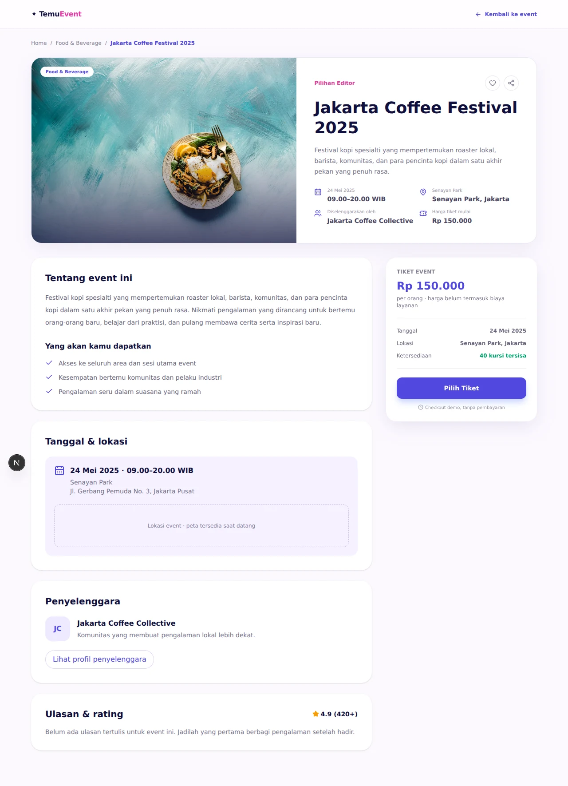
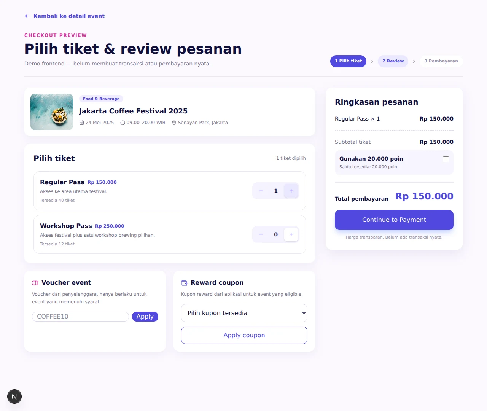

# TemuEvent UI previews

[Project README](../../README.md) · [Shared UX reference](../shared/ux-reference.md)

Captured: 18 October 2026. Static UI snapshots, updated manually. Follow the source/run links for interactive use.

## Feature 1

Author: Rizky. Source commit: [`cd58275`](https://github.com/wilisail/event-management-platform-pwdk/commit/cd582753a480d68ce14e00021a52f8ec93d8372f). The original event-photo URLs were loaded for these captures.

### Discovery — `/`

### Event details — `/events/1`

### Checkout — `/events/1/tickets`

One Regular Pass selected; other choices remain unapplied.

## Feature 2

Author: Wili. Source commit: [`a2db178`](https://github.com/wilisail/event-management-platform-pwdk/commit/a2db1781b1aefacd03d5208c72f05d3e3eadb8e0). [Source and run instructions](https://github.com/wilisail/event-management-platform-pwdk/blob/feature-2/feature-2/README.md).

### Account and rewards — `/`

Customer demo persona with fixture points and coupons. Production login, persistence and purchase/reward writes are pending. Styling follows feature 1.

