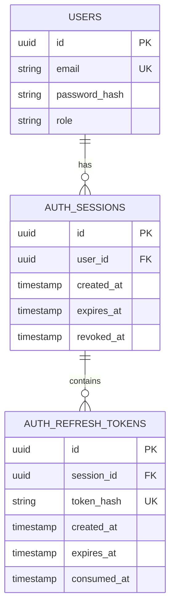

# Account and session foundation

Updated: 31 October 2026. Database foundation, registration, login/session/JWT/cookie handling, refresh and logout are implemented on feature-2. [Reusable authentication/role/CSRF guards and protected organizer reads](authorization-reference.md) are also implemented. Frontend authentication wiring is next. See [registration](registration-reference.md) and [session mechanics](login-session-reference.md).

## Records and relationships



| Record | Meaning | Reason for its own table |
| --- | --- | --- |
| User | A customer/organizer account | Identity persists across logins, purchases and event ownership. |
| AuthSession | One sign-in, with an absolute expiry and optional revocation | A user can sign in on a phone and laptop; revoking one session does not delete the account or automatically revoke the other. |
| AuthRefreshToken | One random refresh credential's SHA-256 hash and consumption history | Rotation creates a new token record and marks the previous one consumed. History supports detecting reuse within the same session. |

`User.sessions AuthSession[]` in Prisma is a relation field, not an array column added to `users`. The stored foreign key is `auth_sessions.user_id`. Likewise, `auth_refresh_tokens.session_id` links each token to its session. Each record has its own UUID primary key.

The existing user columns, IDs, roles and referral codes are unchanged. The two seeded users still have null password hashes and cannot sign in with a password.

## How the full stack will use these records

| Layer | Responsibility |
| --- | --- |
| Browser / Next.js / React | Display register/login/profile forms and send requests. Browser cookie handling carries credentials; hidden buttons alone do not enforce permission. |
| Express on Node.js | Validate input, hash/verify passwords, issue and verify credentials, check the persisted session, and enforce the user's role/ownership. |
| Prisma | Provide typed queries and joins, using the shared schema and a generated client inside the backend. |
| PostgreSQL | Store accounts/sessions/token hashes, enforce foreign keys and constraints, and commit related changes atomically. |
| Supabase | Host PostgreSQL. These tables do not select Supabase Auth or expose the application's database login to the browser. |

There are three different identities: the human Supabase dashboard member; the backend database login `temuevent_app`; and application users whose role is `CUSTOMER` or `ORGANIZER`. Sharing the backend connection between builders does not sign a customer into the application.

## Credential flow

After password verification, the server creates an AuthSession and initial AuthRefreshToken together. Login returns a fifteen-minute signed access JWT and a refresh secret in HttpOnly cookies. The access JWT identifies the user and session; the session has a seven-day absolute expiry. These working defaults are implemented in the service, not hardcoded by the migration.

The database stores only a SHA-256 hash of the high-entropy random refresh secret. A refresh secret is not a password; passwords use salted scrypt. JWT signing keys and raw credentials stay outside public Git and API profile responses.

For a protected request, Express must verify the JWT and check that the referenced session is unrevoked and unexpired. It must obtain the authoritative role/ownership from backend data. A session ID alone is not proof of authentication.

A representative Prisma query for a session check is:

```ts
const session = await prisma.authSession.findFirst({
  where: {
    id: verifiedClaims.sid,
    userId: verifiedClaims.sub,
    revokedAt: null,
    expiresAt: { gt: now },
  },
  select: {
    id: true,
    user: { select: { id: true, name: true, role: true } },
  },
})
```

This query illustrates the check; the implemented repository uses an equivalent session lookup and expiry/revocation checks. Claims first pass cryptographic JWT verification. Password and token hashes are absent from the identity response.

Logout sets `revokedAt`; expiry is enforced by the service against server time. Storing an expiry timestamp alone does not create a timer or enforce an HTTP response. Cookie settings and implemented lifetimes are documented in the session reference.

## Rotation and SQL transactions

A refresh operation checks both the token and parent session. An unexpired token does not make an expired or revoked session valid. Consuming the old token and inserting its replacement commit in the same SQL transaction.

Refresh locks the parent session, then re-reads the token before consuming it. Logout locks the same row. Reusing a consumed token commits session revocation and returns 401. Backend endpoints are implemented; frontend coordination between simultaneous refreshes/tabs remains part of the client wiring batch.

Foreign keys prevent orphan sessions/tokens. Unique token hashes prevent storing the same credential twice. SQL checks enforce expiry after creation, revocation/consumption at or after creation, and the expected 64-character lowercase hexadecimal hash format. Cross-record expiry eligibility remains a backend check.

Indexes support session lookup by user, token lookup by session, and expiry maintenance. The unique hash index supports credential lookup. Database-owner cleanup can cascade from a session to its token history; the runtime role has no DELETE grant.

## Access and migrations

Both new tables are in the private `temuevent` schema with RLS enabled. The existing backend role receives SELECT/INSERT/UPDATE. Public/Data API roles have no table access; the backend role gains no schema-creation or migration-history access. This trusted server role does not implement end-user authorization.

The ordered migration lives in `database/prisma/migrations`. It was applied through the authorized Supabase migration connection and registered as applied in Prisma history with the exact SQL checksum. It was not executed by Prisma migrate deploy. No shared database reset was run.

The shared Prisma schema and feature 2's local schema mirror contain the same models. Feature 1's current database queries and frontend remain its builder's implementation; existing user/event/purchase columns are unchanged. Registration now creates accounts without issuing a session; shared login APIs will follow in the next batch.

## Verification on 31 October 2026

From `database`, with the existing supplied backend environment:

```bash
npm run db:validate
npm run db:generate
npm run db:verify:auth
```

The cloud VM verification used the actual backend role and verified TLS connection. It checked multiple sessions per user, joined token-to-user relationships, one-time conditional consumption, independent session revocation, expired-session rejection in active queries, foreign-key/unique/date/hash constraints, and rollback cleanup. TypeScript checked the new verification script. The original purchase/inventory verification also passed.

All foundation and later HTTP/session verification writes were rolled back. The live database retains two sample users, three events and thirty purchases; both auth tables are empty until a real, non-test login is performed. The [session reference](login-session-reference.md) records the subsequent login/refresh/logout HTTP tests. Security checks found no new warnings/errors.

## Course connections

| Course topic | Concrete example in this batch |
| --- | --- |
| Relational design / normalization | Account identity is stored once; sessions and token history reference it through foreign keys. |
| SQL keys, indexes and constraints | UUID primary keys, unique hashes, indexed foreign keys and timestamp checks. |
| Prisma ORM and migrations | Typed relation models/client generation plus one ordered SQL history. |
| Authentication / authorization | Session verification, reusable role/CSRF guards and organizer ownership filters are implemented; browser wiring is next. |
| Transactions / reliability | Consume-and-replace writes must succeed together; verification writes roll back. |
| Secure coding / testing | Private backend access, token hashes rather than raw secrets, and tests against real database constraints. |

References: [OWASP session management](https://cheatsheetseries.owasp.org/cheatsheets/Session_Management_Cheat_Sheet.html), [PostgreSQL constraints](https://www.postgresql.org/docs/17/ddl-constraints.html), [Prisma 7 migration customization](https://www.prisma.io/docs/orm/v7/prisma-migrate/workflows/customizing-migrations), [Supabase API security](https://supabase.com/docs/guides/api/securing-your-api).

