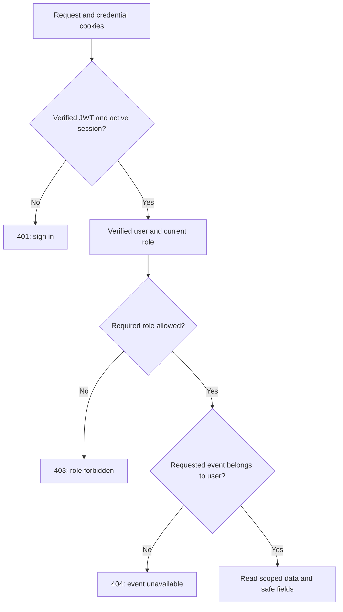

# Authentication, roles and ownership

Updated: 31 October 2026. Sub-batch 3 is implemented on `feature-2`: reusable backend guards, authenticated identity and organizer reads. Frontend signup/login wiring is the next sub-batch. The account/reward preview screens still use fixtures.

## Three separate checks

| Check | Question | Authority |
| --- | --- | --- |
| Authentication | Who is making this request? | Verified JWT plus an active session/user in PostgreSQL |
| Role authorization | May that kind of user perform this operation? | Current CUSTOMER/ORGANIZER role in the user record |
| Record ownership | May this organizer access this event? | Event organizer ID compared with the authenticated user ID |

House analogy: authentication checks the visitor's pass; role checks which rooms it permits; ownership checks whether this is their room. A valid organizer login does not grant access to all organizers' attendee lists.



Ownership applies to event-specific reads. `/api/me` only needs authentication and returns the caller's identity.

## How the stack implements this

Node.js runs Express. Middleware checks requests before the handler runs. The session service verifies the cookie's JWT and queries the live session/user through Prisma. PostgreSQL stores those records and event relationships; Supabase hosts PostgreSQL. A protected handler receives server-established context in `res.locals`, not an actor chosen from headers, query strings or the request body.

| Component | Responsibility |
| --- | --- |
| `requireAuthentication` | Verify credentials/session; attach verified identity; deny missing, expired or revoked sessions |
| `requireRoles` | Require an explicit allowed role; deny absent context or a wrong role |
| `requireCsrf` | For future mutations, verify the client header and session-bound CSRF value/current refresh record |
| Protected router | Validate inputs and return safe identity/organizer responses |
| Organizer read repository | Query only the authenticated organizer's records using Prisma |

Authentication must run before role checks and handlers. A PostgreSQL role change affects the next protected request without replacing the JWT: role authority stays in the current user record. Caller-supplied `x-role`, `x-user-id` and `x-demo-persona` do not authenticate or elevate a user.

Implementation: [guards](https://github.com/wilisail/event-management-platform-pwdk/blob/feature-2/feature-2/server/auth/authorization.ts), [routes](https://github.com/wilisail/event-management-platform-pwdk/blob/feature-2/feature-2/server/protected-http.ts), [Prisma reads](https://github.com/wilisail/event-management-platform-pwdk/blob/feature-2/feature-2/server/organizer/read-repository.ts).

## Implemented API

| Route | Access | Result |
| --- | --- | --- |
| `GET /api/me` | Valid customer or organizer session | Safe UserView in `data`, including the caller's UUID and current role |
| `GET /api/organizer/events` | Organizer | Only owned events: ID, name, category/location/venue, ISO dates and status |
| `GET /api/organizer/events/:eventId/attendees` | Organizer who owns the event | Confirmed purchase rows: customer ID/name, purchase ID/reference, ticket quantity and total paid in IDR |

Lists use `data.items` and `data.pagination` with page, pageSize, total and totalPages. Defaults: page 1 and pageSize 10. Limits: pageSize 50 and page 10,000. Ordering uses date plus ID. Invalid UUID/pagination/unknown query fields return 400; an empty owned list returns 200 and `items: []`.

Attendee rows include **DONE purchases only**, including confirmed zero-price purchases. Pending/rejected/expired purchases are excluded. One row represents one purchase; a customer with several purchases can appear more than once. Quantities sum that purchase's items, and totalPaid uses its final paid amount. Customer email, password hashes and credentials are excluded. BIGINT amounts are explicitly converted to safe whole-rupiah JSON numbers; precision loss is refused.

These are confirmed registrations, not proof of attendance. The later check-in operation and feature 1 review eligibility must distinguish registering from actually attending.

## Why role checks alone are insufficient

The event list filters by the authenticated organizer ID. The attendee route checks ownership, then repeats the owner predicate in both purchase data/count queries. A changed URL cannot select another organizer's records. Another organizer's event and a missing event return the same 404. Customers receive 403 before event data is queried; invalid sessions receive 401. These error defaults can be coordinated without a schema change.

The backend database login `temuevent_app` is distinct from an application's CUSTOMER/ORGANIZER role. Its existing grants/RLS allow trusted backend queries; backend permissions and query filters still decide which records an end user may see. Supabase dashboard membership is a third, separate identity.

## Writes and feature integration

The reusable CSRF guard checks that the refresh record belongs to the same session as the verified access credential, is unconsumed/unexpired and has an active parent session. A valid CSRF value from a different login is rejected, even for the same user. Multipart uploads are supported; this guard does not force JSON onto proof-upload forms. Each runtime must also retain the explicit origin allowlist.

This batch adds no approval/purchase/upload mutation. Future write handlers must mount the guards, check record ownership and enforce business rules in their SQL transaction. Middleware alone does not reserve seats, prevent double spending or make later writes atomic. It does not cancel requests already in flight when a session is revoked.

Feature 1 keeps event creation, checkout and purchase rules. Feature 2 can now read shared events and confirmed purchases for its dashboard. Integration can reuse these guards/session authority when the shared backend is wired. Existing feature 1 routes do not become protected merely because helpers exist on feature-2. Shared IDs, roles and Rizky's UI direction are unchanged.

## Verification and learning checkpoint

On 31 October, TypeScript and all **66 unit/API tests** passed. Real HTTP/database verification registered a customer and two organizers, logged them in, created temporary event/ticket/purchase fixtures and checked identity, wrong-role access, cross-organizer protection, pagination, confirmed quantities/IDR totals, free confirmations, current role changes, CSRF/session binding, access expiry, refresh and logout.

All temporary accounts, events, tickets, purchases and session history rolled back together. Unit HTTP tests also exercise a test-only multipart write with mixed-session cookies; no test mutation endpoint is installed in the application. Browser form behavior remains the next checkpoint.

Run from `feature-2` with the existing private environment:

```sh
npm run typecheck
npm test
npm run db:verify:authorization
```

No new dependency, provider account, migration, grant or secret is required. Course connections: Express middleware order, role-based authorization, Prisma relations/filtering, Zod validation, JSON serialization and backend testing. Be ready to explain why 401, 403 and ownership-denied 404 differ, why a hidden button cannot enforce permission, and why a database role is different from an application role.

Next: connect browser forms, authenticated navigation and the API client, then verify the browser journey. Decisions, emails, statistics charts, reward issuance and actual attendance remain later work.

References: [Express middleware](https://expressjs.com/en/guide/using-middleware/), [OWASP authorization](https://cheatsheetseries.owasp.org/cheatsheets/Authorization_Cheat_Sheet.html), [Prisma 7 pagination](https://www.prisma.io/docs/orm/v7/prisma-client/queries/pagination), [login/session mechanics](login-session-reference.md).
