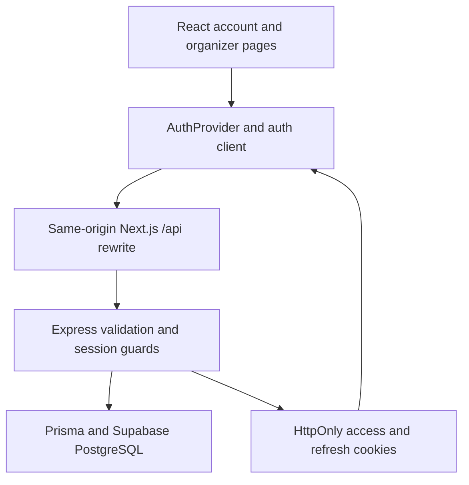

# Frontend authentication — companion note

Updated: 31 October 2026. Sub-batch 4 is implemented on `feature-2`. This connects the previously tested registration/session/authorization backend to the feature 2 pages. Rizky's original logo, colours and visual direction are retained; feature 1 source is unchanged.

## What now connects

The frontend is the interface; Express decides whether the request is allowed. Prisma queries the database. Supabase hosts PostgreSQL. Next.js serves the existing React application and forwards `/api` requests to Express; it does not replace Express or the database.

| Page | Data and behavior |
| --- | --- |
| `/register` | Real account creation with name/email/password, customer/organizer role and optional referral. A valid referral issues both rewards atomically. Shows success, then offers a separate login. See [referral signup](referral-registration-reference.md). |
| `/login` | Real password login; updates the account context and navigates to the permitted destination. |
| `/account` | Protected identity, role and immutable referral code from `/api/me`. Profile editing, uploaded pictures and the real reward wallet are pending; no example reward balance is presented as real. |
| `/organizer` | Organizer-only owned event list and confirmed participant rows from the protected APIs. Loading, retry, empty states, pagination and a customer access-denied view are included. |
| `/preview` | Original account/reward fixture UI, explicitly labelled as an example. Demo persona selection does not create a login session. |
| `/organizers/:id` | Existing fixture public profile. Connecting real public organizer information and feature 1's rating summary remains planned. |

The root redirects to `/account`. An anonymous visitor is then sent to login. A confirmed purchase is registration data, not proof that the person attended the event.

## Mechanics: what, why and how

| Building block | Why it exists | How this implementation uses it |
| --- | --- | --- |
| Form state | Explain pending/invalid/service-failure outcomes | Controlled status/error state, labelled inputs, disabled pending submission and an accessible error message. Password values are not persisted in browser storage. |
| `AuthProvider` / React context | Let the header and pages share the current identity | Loads `/api/me`; tracks loading/authenticated/anonymous/error states. Login/logout update that view. The backend remains the authority for identity and roles. |
| Same-origin API rewrite | Keep browser cookies and requests on the application origin | Browser requests use relative `/api/...`; Next forwards them to `F2_API_ORIGIN`, with the existing `F2_DEMO_API_ORIGIN` as a compatibility fallback. |
| HttpOnly cookies | Carry authentication without exposing credentials to React | The browser sends cookies with `credentials: 'include'`. React never reads the access/refresh secrets or puts them in localStorage. Production cookies are Secure, host-only, SameSite=Lax and `__Host-` prefixed. |
| CSRF value | Bind an authenticated write to the current session | Refresh/logout retrieve the current `/api/auth/csrf` value, then send `X-CSRF-Token`. JSON auth writes also send `X-TemuEvent-Client: web`. The CSRF value is not a login credential. |
| Frontend route guard | Give the visitor a useful navigation outcome | Sends anonymous users to login, shows service failures separately and prevents displaying organizer content for a customer. Direct API requests still face the backend guards. |
| Abort/version guards | Avoid stale responses changing a new page/session | Page reads abort on cleanup; identity reloads use a version counter so an earlier response cannot overwrite a later login/logout. |

Registration and login are separate operations: creating a user row does not itself establish an authenticated session. The existing backend hashes passwords, sets credential cookies on login and verifies both the access signature and persisted session on protected requests. See [registration](registration-reference.md), [login/session](login-session-reference.md) and [authorization](authorization-reference.md).

## Refresh and logout

The backend's strict refresh-token reuse policy makes coordination necessary:

1. A protected GET receives 401. Requests in the same tab share one refresh promise.
2. A Web Lock named `temuevent-auth` serializes refresh/login/logout across tabs on this origin.
3. After acquiring the lock, the client rechecks `/api/me`: another tab may already have refreshed or logged in.
4. If needed, it retrieves current CSRF, rotates once and retries the original GET once.
5. If the refresh response is uncertain, automatic refresh stops and the UI requests login. It does not blindly retry a possibly committed rotation.

`BroadcastChannel` shares only changed/uncertain messages, never passwords or tokens. When Web Locks are unavailable, sign-in still works, but expired access requires signing in again rather than uncoordinated automatic rotation. Actual multiple-tab browser behavior still needs a manual check.

Writes are never automatically replayed. A purchase/proof mutation will need its own agreed idempotency behavior. Logout obtains current CSRF under the same lock, revokes the server session and clears the UI after success; a network failure is shown instead of pretending logout succeeded.

## Boundary with feature 1

| Shared concern | Current state / remaining work |
| --- | --- |
| Logo/theme | Feature 2 follows [Rizky's original UI source](../ui/README.md). No new colour or logo direction is introduced. |
| Account identity | Real `/api/me` supplies UUID, role and safe user fields. A feature 1 customer/organizer ID from a form or demo selector is not authentication. |
| Return after login | Only feature 2's own `/account` and `/organizer` destinations are currently allowed. Restoring feature 1 ticket selection requires an agreed trusted checkout route/intent; arbitrary external return URLs are rejected. |
| Shared deployment | Combined browser traffic should use one origin and one session/transaction authority. Feature 1 is not automatically connected or protected by this feature 2 implementation. |
| Reward picker | Real referral reward issuance is implemented. Authenticated wallet reading and reservation come next. The example wallet remains under `/preview` and demo APIs. |
| Organizer decisions | Only owned event/confirmed-attendee reads are connected today. Proof viewing, accept/reject, restoration, emails and charts are subsequent work. |

The existing standalone entry point remains useful for independent grading. The integrated application must exercise the actual shared purchase/reward services, not fixtures.

## Verification and limits

- TypeScript, all 74 unit/API/client tests and a production build passed for this checkpoint.
- Login and registration pages were inspected in the cloud browser with the original logo/theme; the registration-to-login navigation is wired.
- The reusable client tests cover return-path restrictions, JSON/credential settings, concurrent read refresh, another-tab recheck, uncertain refresh, 403 handling, no write replay, logout CSRF and controlled proxy failures.
- `feature-2/scripts/verify-frontend-client.ts` passed against the actual HTTPS Next proxy, Express services, Prisma and Supabase: account creation, separate login, identity, customer 403, owned event/attendees, one refresh for simultaneous expired-access reads, logout and Secure/HttpOnly/SameSite/Path cookie attributes. Its in-memory cookie transport is an HTTP test, not a browser password-form test.
- Automated password-form entry was not performed: the cloud browser's authentication guidance reserves sign-in credential entry for the user. A manual register/login, page reload, wrong-role page, multiple-tab refresh and logout UI check remains before release.

The temporary VM preview is a test environment, not the final evaluator deployment. No cookie/origin security setting is weakened for the preview. QA data is held in an outer SQL transaction and rolled back on shutdown; no existing seed account password is reset.

QA shutdown confirmed rollback. The persistent baseline remains 2 users, 3 events, 4 ticket types and 30 purchases, with 0 sessions and 0 refresh-token records. No database credentials changed.

Deployment follow-up: Express currently leaves `trust proxy` disabled, so rate limits use the immediate peer (the Next proxy in this layout) rather than trusting forwarded client-IP headers. The HTTPS check logged the rate-limit library's forwarded-header configuration warning; requests and authorization still passed. This conservatively shares a rate-limit bucket behind a proxy. Configure the exact trusted proxy topology during deployment and verify that a caller cannot spoof its source IP; do not simply enable blanket proxy trust or disable rate limiting.

## Learning checkpoint

Be able to explain these without reading the code:

- Why changing React state to `authenticated` cannot grant database access.
- Why a successful registration response is different from a session cookie.
- Why the database address/password is needed by Express/Prisma but not the browser.
- Why HttpOnly and CSRF solve different problems.
- Why two tabs rotating the same refresh token need coordination.
- Why a GET may be retried after refresh while a purchase must not be blindly repeated.
- Which response distinguishes missing login (401), wrong role (403), and an unavailable account service.

Course connections: forms/hooks/context/network calls; REST/Express middleware; Prisma/PostgreSQL; JWT/refresh authorization; secure coding; asynchronous state and testing. The existing Next.js application is retained from the accepted prototype rather than changing the frontend framework during this batch.

Primary references: [Next.js rewrites](https://nextjs.org/docs/app/api-reference/config/next-config-js/rewrites), [useSearchParams and Suspense](https://nextjs.org/docs/app/api-reference/functions/use-search-params), [Web Locks](https://developer.mozilla.org/en-US/docs/Web/API/Web_Locks_API), [BroadcastChannel](https://developer.mozilla.org/en-US/docs/Web/API/BroadcastChannel), [Express behind proxies](https://expressjs.com/en/guide/behind-proxies/).

Next: [dated feature 2 completion plan](feature-2-completion-plan.md).
