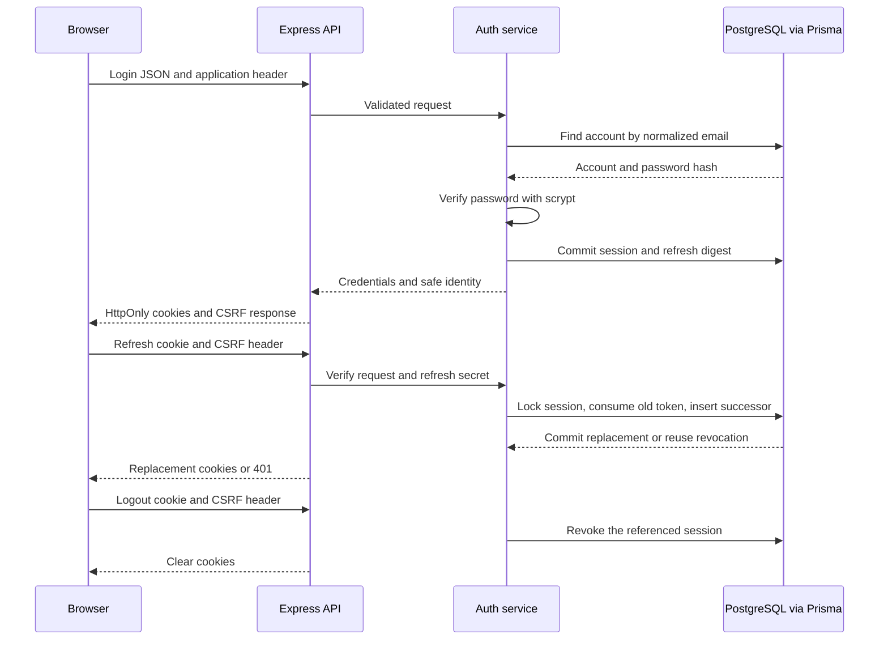

# Login and session reference

Updated: 31 October 2026. Implemented on `feature-2`. This is the second authentication sub-batch: password login, persisted sessions, refresh rotation, CSRF handling and logout. Reusable role/ownership middleware and frontend form wiring are separate next steps. The current account/reward preview still uses fixtures.

## Account, session and credentials

| Term | Meaning in this application | House analogy |
| --- | --- | --- |
| Account | One `temuevent.users` record with identity, role and password hash | Resident entry in the register |
| Session | One login, linked to that user, with expiry and revocation | One issued visitor pass on the desk's list |
| Access JWT | Signed user/session identifiers, valid for at most 15 minutes | Short-lived badge checked at the door |
| Refresh token | Random 256-bit secret that can replace an expired access credential | A replacement slip, exchanged once |
| Cookie | Browser-managed transport/storage for a credential | The holder carrying the badge/slip |
| CSRF token | A session-bound value added to application write requests | A separate check that the request came through the application |

The account remains when a user logs out. One user can have separate phone/laptop sessions. Logging out one session leaves the other active. A session ID is an identifier, not proof that its sender owns that session.

## How the layers connect



Node.js runs Express. Express handles HTTP, request limits, cookies and responses. The service implements login/session rules. Prisma maps those rules to parameterized queries and SQL transactions. PostgreSQL enforces relationships and commits the records; Supabase hosts that PostgreSQL instance. This uses the application's private `temuevent` schema, not Supabase Auth or the Data API.

Implementation: [service](https://github.com/wilisail/event-management-platform-pwdk/blob/feature-2/feature-2/server/auth/sessions.ts), [token functions](https://github.com/wilisail/event-management-platform-pwdk/blob/feature-2/feature-2/server/auth/session-tokens.ts), [Prisma repository](https://github.com/wilisail/event-management-platform-pwdk/blob/feature-2/feature-2/server/auth/session-repository.ts), [HTTP router](https://github.com/wilisail/event-management-platform-pwdk/blob/feature-2/feature-2/server/auth/session-http.ts).

## Password check and token signing

Login accepts only email and password. Zod trims/lowercases email and rejects extra fields, including caller-supplied roles. Password characters remain unchanged. Existing salted scrypt hashes are verified; incorrect, nonexistent and passwordless accounts return the same `401 INVALID_CREDENTIALS`. Missing accounts still perform supported-cost dummy password work. The shared two-job hashing bound and ten login attempts per IP per fifteen minutes limit expensive work; deployment-wide/account-level controls remain a future hardening choice.

`jose` 6.2.14 signs/verifies access JWTs with HS256 and a private 32-byte key. Claims include user ID (`sub`), session ID (`sid`), issuer, audience, issue/expiry times and a token ID. Verification checks the signature, algorithm, intended issuer/audience and lifetime. Merely decoding a JWT is not verification. A signed JWT is not encrypted; passwords, email, database credentials and authoritative roles are omitted.

Each session check also reads PostgreSQL and rejects revoked/expired sessions. The current role comes from the user record, not an old token claim or `x-demo-persona`. This makes revocation effective for subsequent requests before access-token expiry. The tradeoff is a database read; in-flight requests are not retroactively canceled.

Passwords and refresh secrets need different hashes. Human passwords need slow scrypt to make guessing costly. Refresh secrets already have 256 bits of randomness, so a fast SHA-256 digest supports indexed lookup without storing the raw secret. Hashing, JWT signing, TLS and cookies have different jobs; none replaces the others.

## Rotation, expiry and SQL transactions

Working defaults: access lifetime **15 minutes**; session/refresh absolute lifetime **7 days from login**. Refresh does not extend that seven-day deadline. These durations are implementation choices, not PRD-mandated timings, and can change with corresponding tests and client updates.

Login commits the session and initial refresh-digest record together. Refresh looks up the digest, locks its parent session with `SELECT ... FOR UPDATE`, re-reads state after acquiring the lock, checks expiry/revocation, marks the old token consumed and inserts its replacement in one transaction. Logout locks the same session before revocation.

Reusing a consumed refresh credential revokes that session, including its newer credentials. The repository returns that outcome so revocation commits; throwing inside the SQL transaction would roll it back. The service then returns a generic 401. Refresh history is retained; runtime code does not delete it.

This strict reuse policy means the frontend must coordinate refresh requests, including between tabs, and must not automatically replay a refresh after an uncertain network result. The client helper is a later sub-batch. Purchase/proof mutations likewise must not be blindly retried after login refresh.

## Browser and API contract

Both credential cookies are HttpOnly, host-only, `Path=/` and `SameSite=Lax`. Production adds `Secure` and the `__Host-` prefix; development HTTP uses unprefixed names. Raw access/refresh credentials are never returned in JSON or stored by this implementation in localStorage. Authentication responses use `Cache-Control: no-store`.

| Route | Behavior |
| --- | --- |
| `POST /api/auth/login` | JSON email/password. Sets access/refresh cookies; returns safe user, CSRF token and expiry timestamps. |
| `GET /api/auth/csrf` | Derives the CSRF value for the refresh cookie after reload; this response alone is not proof of a valid session. |
| `POST /api/auth/refresh` | Verifies the refresh cookie and CSRF header, rotates once and replaces both credential cookies/CSRF value. |
| `POST /api/auth/logout` | With a refresh cookie, verifies CSRF and revokes that session; clears cookies. No-cookie logout succeeds idempotently. |
| `GET /api/auth/session` | Inspects the verified active session and returns safe identity. This batch's inspection endpoint; reusable protected application routes follow separately. |

New authentication POST routes require `X-TemuEvent-Client: web` and JSON. Refresh/logout with a refresh cookie also require `X-CSRF-Token`; that HMAC is bound to the current refresh secret. Credential cookies are HttpOnly, while the frontend may keep the returned CSRF value in memory. This is why a CSRF value can appear in JSON while authentication secrets do not.

Express uses an explicit origin allowlist and credentialed CORS; cross-site fetch metadata is rejected for these writes. CORS is a browser boundary, not authentication. Use same-origin `/api` routing in the integrated deployment. Local frontends/API should use consistent hostnames with `credentials: 'include'` when needed. Deploying the browser and API on unrelated sites would require a deliberate cookie/CSRF design change; the current SameSite settings do not support that layout.

Responses: 400 invalid input/JSON, 401 incorrect credentials or invalid session, 403 origin/client/CSRF rejection, 413/415 body-size/content-type rejection, 429 throttling and 503 unavailable configuration/database/hash capacity. Unexpected internal errors do not expose connection details. Rate-limit storage is process-local; multiple API instances require a shared store and explicit trusted-proxy configuration.

## Configuration and verification

The ignored backend `.env` uses the existing `DATABASE_URL` plus `AUTH_JWT_SECRET` (64 hexadecimal characters). A development signing key is prepared in the private backend handoff; no database password changes or new provider accounts are needed. Do not put either value in Git or `NEXT_PUBLIC_*` variables. Keep a key stable across restarts; production will have its own hosting secret. Key rotation requires considering access and CSRF credentials already issued under the previous key.

Without the signing key, registration and fixture routes remain available while session routes return 503. With both settings, the actual `server/index.ts` bootstrap reports both features configured. Production cookies require HTTPS. Schema/permissions from the previous session-foundation migration are sufficient; this batch adds no migration or grants.

From `feature-2`:

```sh
npm ci
npm run typecheck
npm test
npm run db:verify:sessions
```

On 31 October, all **57 tests**, TypeScript, a clean dependency install/client generation, the actual server bootstrap and live HTTP/database verification passed. The live verifier exercises registration, scrypt login, session/digest persistence, access expiry, refresh rotation, consumed-token replay, CSRF rejection, logout and isolation between separate logins. A controllable clock tests fifteen-minute/seven-day boundaries without waiting.

The live database checks run sequentially inside an outer transaction and roll back all temporary records. Concurrent refresh policy is covered by an isolated simulated test; that test is not a multi-connection database race test. Database state afterward remained 2 sample users, 30 purchases and no test sessions/tokens. Browser form behavior is not claimed by these API checks.

## Learning checkpoint and remaining work

| Course topic | Concrete mechanic to explain |
| --- | --- |
| Express/REST and validation | Middleware order, JSON boundaries, generic 401 versus forbidden 403 |
| Authentication and refresh tokens | Password proof, signed access, rotating refresh, absolute expiry and revocation |
| SQL/Prisma | User/session/token foreign keys, hash lookup, parent-row lock and atomic rotation |
| Secure coding | Private keys, safe responses, HttpOnly/Secure cookies, CSRF and verified TLS |
| Testing | Dependency-injected rules, real HTTP, persisted reads and rollback cleanup |

The next checkpoint adds reusable authenticated-user/role middleware and protected endpoints. The following checkpoint connects signup/login forms and verifies the flow in the browser. Incoming-referral rewards, password reset, real reward/dashboard operations and deployment remain later work.

Feature 1 can continue its event/purchase implementation. Shared user UUIDs/roles and Rizky's visual direction are unchanged. When wiring checkout authentication, both features will use the agreed session/API helper; feature 1 should not treat a registration response, caller-supplied ID or demo persona as an authenticated user.

References: [OWASP sessions](https://cheatsheetseries.owasp.org/cheatsheets/Session_Management_Cheat_Sheet.html), [OWASP CSRF](https://cheatsheetseries.owasp.org/cheatsheets/Cross-Site_Request_Forgery_Prevention_Cheat_Sheet.html), [jose signing and verification](https://github.com/panva/jose), [Prisma 7 transactions](https://www.prisma.io/docs/orm/v7/prisma-client/queries/transactions).
