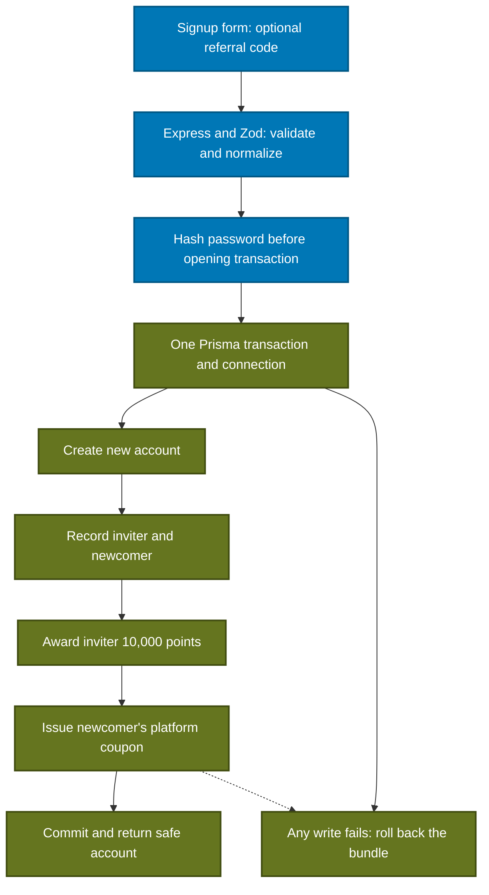

# Referral signup and reward issuance — companion note

Updated: 1 November 2026, Asia/Jakarta. Day 2, subpart 2. Implemented on `feature-2`: an optional incoming referral code now creates the account, referral-use record and both rewards atomically. The real wallet and checkout reservation/restoration services remain the next subparts.

## Request to database

The referrer lookup also happens inside the transaction, before creating the new account. A missing code returns a controlled error with no new account/rewards. Signup without a code remains a single account insert.

## Who gets what

If Ayu's existing code is entered when Budi registers:

| Recipient / record | Result |
| --- | --- |
| Budi | New account and his own new immutable referral code |
| Referral | One record linking Ayu as referrer to Budi as newcomer |
| Ayu | A separate 10,000-point grant, initially all unspent |
| Budi | One platform reward coupon |
| Both rewards | Expire three calendar months after the recorded credit/issue time |

A user's own generated code, an incoming inviter code and an issued coupon code have separate purposes. Referral/coupon identifiers are shareable application data; authentication still requires a password login and session.

## Rules and configuration

| Rule | Implemented behavior |
| --- | --- |
| Incoming code | Optional; trim outside whitespace and normalize uppercase; at most 16 alphanumeric characters. Empty/absent means ordinary signup. |
| Invalid/missing code | Bad format returns `INVALID_REGISTRATION`; a well-formed unknown code returns `INVALID_REFERRAL_CODE`. Both return 400 without creating the account. |
| Account fields/roles | Existing name/email/password rules and `CUSTOMER`/`ORGANIZER` roles remain. A caller cannot supply account IDs, hashes, reward amounts or expiry dates. |
| Points | Exactly 10,000, credited to the referrer's user ID in a new point-grant row. |
| Coupon value | Working default Rp25,000 from the existing prototype. The PRD does not set the face value. Backend `REFERRAL_COUPON_IDR` can override it with a positive safe integer amount in whole IDR. |
| Policy changes | Configuration affects future issuance. Each existing coupon retains the amount recorded when it was created. |
| Expiry | Existing UTC calendar-month function, with month-end clamping. Example: 31 January → 30 April. Jakarta display does not change the stored instant. |
| Success | HTTP 201 with the same safe `data.user` fields as ordinary signup. Registration still does not issue a session/login cookie. |
| Duplicate account | Normalized email already registered → HTTP 409 `EMAIL_IN_USE`; no second referral or rewards. |
| Infrastructure/write failure | Controlled 503 without exposing database details; transaction rollback prevents a partially fulfilled signup. |

Both existing account roles continue to register. Reward ownership is recorded by user ID; purchase/reward redemption permissions remain a separate customer checkout boundary. The coupon amount is a project working default open to input, not a rule inferred from an external ticketing website.

## What makes the operation atomic

`server/index.ts` supplies the repository with `client.$transaction(work, { timeout: 10000 })`, using pinned Prisma 7.10.1. Inside that callback, the repository uses only its supplied `tx` connection for the inviter lookup and four writes. It returns the safe user only after the transaction succeeds.

Password hashing happens beforehand. Scrypt consumes CPU and memory; keeping it outside the transaction avoids holding database resources while hashing. The prepared hash is reused for bounded code-collision retries.

| Building block | Why it matters |
| --- | --- |
| Service | Validates user input and owns the 10,000-point, coupon-value and expiry policy. |
| Repository | Implements the complete signup/reward bundle using the transaction connection. |
| Prisma transaction | Commits the grouped writes together or rolls them back when a write throws. |
| PostgreSQL constraints | Enforce email/code uniqueness, one incoming referral per account, correct recipients and valid amounts/dates. |
| Frontend | Sends the optional code and displays success/errors; it does not create reward rows or choose their value. |

An early email lookup improves duplicate feedback. PostgreSQL's unique email index remains the guarantee when requests overlap. Each referral points to one newcomer, and the point grant/coupon each have a unique referral link. Separate point awards are inserted rather than updating a shared user balance; later wallet queries can sum the valid grants.

The repository fails closed if referral signup is requested without a transaction boundary. A test also checks that referral writes never escape to the root client outside the supplied transaction.

## Failures and retries

Consider a failure creating Budi's coupon after his user, referral and Ayu's point grant were written. The transaction rolls back those earlier writes too. The same email can then register successfully after the fault is corrected.

Only a known unique-key collision is automatically retried, at most three attempts. If the email now exists, the service returns 409. Otherwise it generates fresh outgoing referral/coupon codes and retries a new bundle after rollback. A failed coupon-code collision must not leave an extra account or award.

Unknown errors and uncertain network outcomes are not automatically replayed. If a successful commit loses its response, the email/relationship constraints prevent another signup from awarding again; the existing login path lets the user access the created account. Purchase/proof writes retain their separately planned idempotency rules.

## Effect on feature 1 and feature 2

| Area | Effect |
| --- | --- |
| Feature 2 signup | Optional referral input now works against the real database; the existing TemuEvent form styling is reused. |
| Feature 2 wallet | Issued rewards exist in the database. Authenticated wallet APIs/UI are the next subpart; `/preview` remains sample data. |
| Feature 1 checkout | Customer IDs and the signup response shape are unchanged. Checkout should later read the actual issued coupon value/expiry through the agreed wallet service, then reserve through the shared transaction-aware service. |
| Event vouchers | Remain feature 1's organizer-created promotions, separate from these platform referral coupons. |
| Shared database | Uses the five reward tables applied in subpart 1. This batch changes behavior without another migration, provider, credential or access grant. |

## Verification

The live `npm run db:verify:referrals` check exercises Express → registration service → Prisma → Supabase PostgreSQL using the existing backend role. It verifies:

- Real password hashing, safe 201 output and no automatic login/session.
- Normalized incoming code, correct reward recipients, exactly 10,000 points, configurable coupon value and three-month expiry.
- Duplicate replay, unknown referral and optional ordinary registration.
- Injected failures creating the referral, point grant or coupon; each leaves the attempted account/rewards absent.
- Successful retry of an email after a rolled-back failure.
- A real coupon unique-key collision followed by a fresh successful bundle with no duplicate award.

The verifier uses savepoints inside an outer PostgreSQL transaction so it can inspect successful and failed attempts, then roll back every fixture. Production uses the real `$transaction` boundary; test savepoints are not public API controls. These tests use one database connection and do not claim multi-connection load verification. Unit tests additionally simulate overlapping duplicate signup requests.

TypeScript, all **82 tests** and the production build passed. The original `npm run db:verify:registration` also passed with its updated unknown-referral case. The actual server entry point was checked for configured sessions, unknown-referral rejection and duplicate-email conflict; the signup route returned 200 and the referral field was verified in the rendered browser DOM. All successful QA registrations were inside rollback transactions.

The optional referral field is visually checked in the browser preview. Automated signup credential entry remains a manual release check under the cloud browser's authentication guidance; real referral behavior is tested through HTTP/database calls.

The actual auth client also passed signup, duplicate replay and unknown-referral checks through the HTTPS Next proxy into the real QA service. QA shutdown confirmed rollback. The original users/events/tickets/purchases have identical row fingerprints: 2 users, 3 events, 4 ticket types and 30 purchases remain. The temporary preview is not the evaluator deployment.

## Learning checkpoint

Explain without cue notes:

1. Which records are written, and who owns the point grant and coupon?
2. Why does hashing happen before the transaction opens?
3. What happens to earlier writes when the final coupon insert fails?
4. Why does the early email lookup need a database unique constraint as well?
5. Why must every helper use the same transaction connection?
6. How can changing a coupon setting preserve the value of coupons already issued?
7. Why does having database tables differ from implementing the signup operation that writes them?

Course connections: React forms/network requests; Zod validation; authentication/password hashing; Prisma relationships; SQL transactions; asynchronous failure handling; secure response boundaries; unit and database integration tests.

Primary reference: [PostgreSQL transactions and savepoints](https://www.postgresql.org/docs/17/tutorial-transactions.html). The application uses the pinned Prisma 7.10.1 client API recorded in `feature-2/package.json`.
