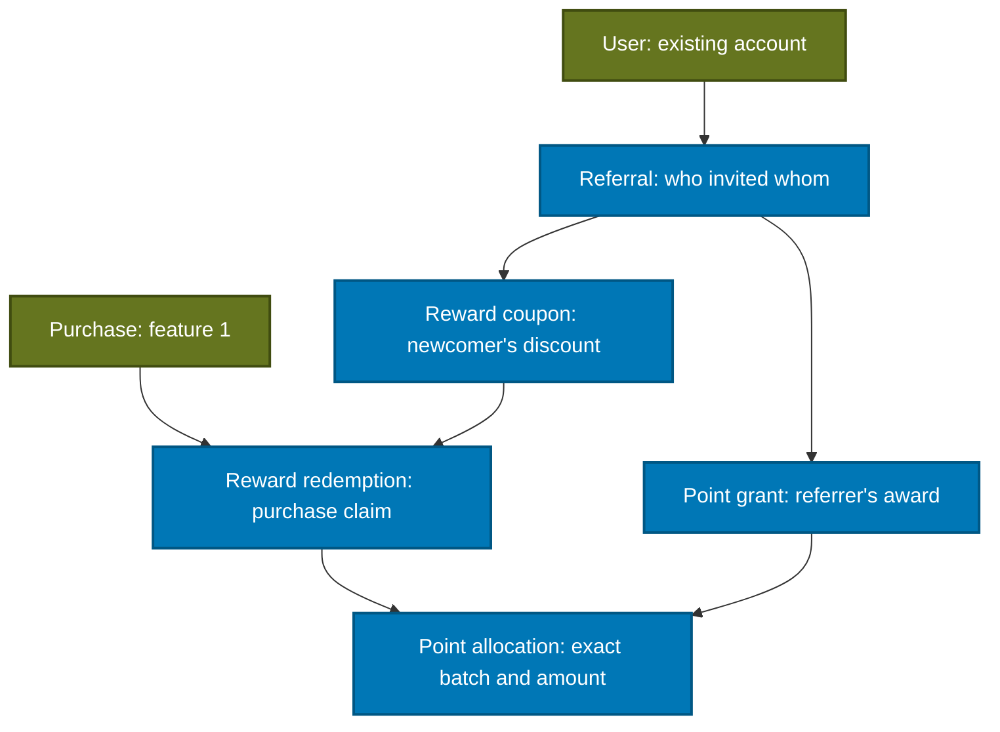

# Referral and reward database — companion note

Updated: 1 November 2026, Asia/Jakarta. Day 2, subpart 1: database foundation. Storage and integrity rules are applied. Atomic incoming-referral signup and issuance are now implemented in [subpart 2](referral-registration-reference.md); the real wallet and checkout operations remain subsequent work.

## Relationships

The blue records belong to the feature 2 reward foundation. The olive records already exist and connect the two features. No event/ticket/purchase screen is changed by this batch.

| Model / SQL table | What one row means | Why it is separate |
| --- | --- | --- |
| `Referral` / `referrals` | A new account registered using another user's referral code | The user's existing immutable code identifies the inviter; this row records an actual use. One newcomer can have at most one incoming referral. |
| `PointGrant` / `point_grants` | One award to the referrer, with original and remaining points plus credit/expiry times | Each award expires independently. A single user balance cannot explain which points expire or should be restored. |
| `RewardCoupon` / `reward_coupons` | One platform coupon owned by the referred newcomer | It can apply across events. It is separate from feature 1's organizer-created event vouchers. |
| `RewardRedemption` / `reward_redemptions` | The rewards reserved/consumed/restored for one purchase | Links the discount to its customer and purchase, preserves history and gives retries a stable purchase identity. |
| `PointAllocation` / `point_allocations` | The amount of one point grant used by one redemption | A purchase can use multiple earning batches; restoration needs those exact batches and their original expiry. |

The credit policy remains 10,000 points to the referrer and a three-month coupon to the newcomer. The PRD does not specify the coupon's face value; the schema stores that issued amount without setting a default. Rp25,000 in QA is test data matching the earlier prototype, not a new fixed product rule.

## Example: earning, spending and returning

If Ayu refers Budi, the signup service creates the following together:

- Budi's account and one referral linking Ayu to Budi.
- A 10,000-point grant owned by Ayu, expiring three calendar months after credit.
- A reward coupon owned by Budi, expiring three calendar months after issue.

Ayu's points and Budi's coupon are different rewards owned by different people. They cannot be combined on a purchase by pretending to be the same customer.

If Ayu later spends 3,000 points from that grant, the purchase's reward redemption records 3,000 points and an allocation links it to that grant. The reservation service must atomically reduce its remaining amount from 10,000 to 7,000. If rejected or expired, the shared restoration service must return the same 3,000 points once. The original expiry remains unchanged; already-expired points do not become newly spendable.

Those service operations are not implemented by creating these tables. The example explains why the fields and relationships are needed.

## What PostgreSQL enforces now

| Rule | Mechanism |
| --- | --- |
| No self-referral | Check that inviter and newcomer IDs differ. |
| No repeated incoming referral or repeated award for that referral | Unique newcomer ID; unique referral link on each point grant and coupon. |
| Correct reward recipient | Composite foreign keys bind the grant owner to the referral's referrer, and the coupon owner to its newcomer. |
| Correct purchase customer | Composite foreign key binds a redemption's owner to the purchase customer. |
| No use of another person's coupon/points | Composite foreign keys include the owner ID when linking the coupon and point allocations. |
| Valid amounts and dates | Whole-number amounts, nonnegative bounded remaining points, positive allocations/discounts and expiry after issue/credit. |
| One reward claim per purchase | Unique purchase ID on redemption. |
| One active claim on a coupon | Partial unique index covers `RESERVED` and `CONSUMED` claims. A `RESTORED` claim remains in history but releases that exclusivity. |
| State timestamps agree | Reserved claims have no terminal timestamp; consumed/restored claims require their corresponding timestamp, with chronological ordering. |
| Preserve issuance/audit records | Runtime backend role cannot update referrals, coupons or allocation records, or delete reward records. It can update point balances and redemption state. |

`RESERVED`, `CONSUMED` and `RESTORED` are reward-claim states. They do not replace the six required purchase statuses. Working mapping: checkout reserves rewards, accepted/confirmed purchase consumes them, rejected/expired/canceled purchase restores applicable rewards through one shared engine.

The extra owner/ID unique pairs support composite foreign keys. The owner appears on both sides so PostgreSQL can reject a valid coupon ID belonging to the wrong customer. Indexes on owner/expiry and relationship columns also support wallet queries and joins.

## What still belongs in the service

- Create account, referral and both rewards in one SQL transaction: now implemented in the [signup service](referral-registration-reference.md). A foreign key alone does not guarantee all records are issued together.
- Apply exactly 10,000 points and the configured coupon value; calculate three calendar months using the agreed UTC/month-end rules. The database validates dates, not this business duration.
- Reserve available, unexpired points using concurrency-safe updates or locks. Nonnegative-balance checks alone do not implement checkout or make stale read/modify/write safe.
- Ensure allocations sum to `pointsUsed`, remaining points agree with claims and purchase discount totals agree with the final price. A row check cannot sum other rows.
- Use conditional state transitions so retries or concurrent expiry/rejection restore resources once. A `RESTORED` enum value alone is not an idempotent restoration service.
- Derive wallet availability from original expiry, remaining amounts and active coupon claims. Expired history stays stored; no timer is required to make an expired reward unspendable.

## How the stack fits

| Building block | Responsibility here |
| --- | --- |
| PostgreSQL on Supabase | Stores rows; checks relationships, uniqueness, amounts and permissions. |
| SQL migration | Applies this additive schema change to an existing database and records its history. It does not create new application screens. |
| Prisma schema/client | Maps SQL names/types to typed TypeScript models such as `pointGrant`. Both app mappings must match the shared schema. |
| Express service, next subparts | Reads the authenticated user, validates input and groups the coupled writes into one transaction. |
| React/Next.js, later wallet subpart | Displays the result through authenticated APIs; receives no database password and does not directly create reward rows. |

These remain private tables in `temuevent`, with RLS enabled and explicit permissions for the existing `temuevent_app` backend role. `anon`, `authenticated` and `service_role` Data API access is not granted. Express must still enforce the actual customer's identity/ownership; the database backend role is shared by trusted server requests and is not a separate role for each customer.

## Migration and verification record

Canonical model: `database/prisma/schema.prisma`. Feature 2's `prisma/schema.prisma` mirrors it for its independently runnable client. The ordered migration is `database/prisma/migrations/20261031212002_referral_rewards/migration.sql`; its timestamp is UTC, while this note's date is Jakarta time.

The migration adds five tables, one reward-state enum and an owner/ID unique index on the existing purchases table. Existing user/event/ticket/purchase data is preserved. It includes SQL checks, the active-coupon index, RLS and explicit backend permissions. No new provider, dependency, database password or public API is required.

Verification passed: Prisma model validation/client generation and TypeScript, the existing 74 application tests, and the live `npm run db:verify:rewards-schema` check through `temuevent_app`. The live verifier exercises valid relationships and invalid/duplicate/cross-owner writes, point/date bounds, coupon release/reuse, allocations and permissions; all fixtures rolled back. Migration checksum: `95704ab3d474e68763438fcb14a69e54bc525e62e1ca1605adf1530d96470ea7`.

The security advisor found no new warning/error. Its existing informational entry for RLS without a policy on the intentionally denied `_prisma_migrations` bookkeeping table remains unchanged; [advisor explanation](https://supabase.com/docs/guides/database/database-linter?lint=0008_rls_enabled_no_policy). No end-user reward tables are exposed through the Data API.

Agents/builders: regenerate your Prisma client after adopting the updated schema. Shared migrations remain maintainer-managed; do not use the runtime connection to reset or recreate the database. Feature 1 can keep its current screens and purchase implementation. Later, its checkout/expiry engine and feature 2's organizer decisions must call the same transaction-aware reward service.

## Learning checkpoint

Explain these in your own words:

1. Why a referral code on a user differs from a referral-use row.
2. Why two 10,000-point awards with different dates cannot be represented accurately by only `users.pointsBalance`.
3. How a primary key, foreign key, unique index and check constraint solve different problems.
4. Why a valid coupon ID is insufficient without checking its owner and active claim.
5. Why storing a redemption status does not itself implement safe restoration.
6. Why Prisma generation can succeed without contacting Supabase, while the live verification requires backend credentials.

Course connections: normalization, one-to-many relations, composite keys, joins/indexes, PostgreSQL constraints, Prisma models/migrations, SQL transactions, secure coding and database integration tests.

Primary references: [PostgreSQL constraints](https://www.postgresql.org/docs/17/ddl-constraints.html), [partial unique indexes](https://www.postgresql.org/docs/17/indexes-partial.html), [Supabase row-level security](https://supabase.com/docs/guides/database/postgres/row-level-security). [Atomic signup/issuance](referral-registration-reference.md) is implemented; next are the real wallet and shared reservation/restoration service.
