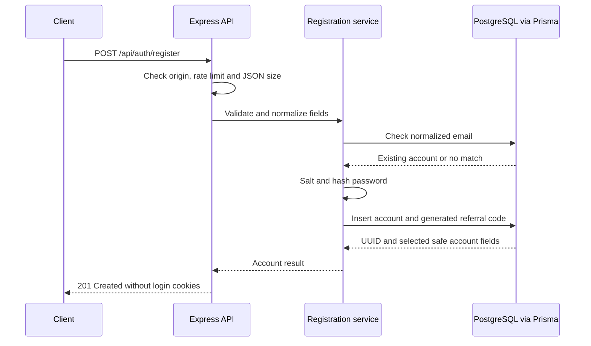

# Registration backend reference

Updated: 31 October 2026. Implemented on the feature-2 branch. This batch creates accounts without an incoming referral; login/session issuance and frontend registration screens remain separate batches.

## Request to database flow



The route handler deals with HTTP. The service implements account-creation rules. The repository maps those rules to Prisma queries. PostgreSQL stores the record and enforces uniqueness; Supabase hosts that PostgreSQL instance.

Implementation: [route](https://github.com/wilisail/event-management-platform-pwdk/blob/feature-2/feature-2/server/app.ts), [service](https://github.com/wilisail/event-management-platform-pwdk/blob/feature-2/feature-2/server/auth/registration.ts), [Prisma repository](https://github.com/wilisail/event-management-platform-pwdk/blob/feature-2/feature-2/server/auth/registration-repository.ts), [password hashing](https://github.com/wilisail/event-management-platform-pwdk/blob/feature-2/feature-2/server/auth/passwords.ts).

## Input contract

POST /api/auth/register accepts JSON:

```json
{
  "name": "Learning Customer",
  "email": "learning@example.test",
  "password": "replace-with-your-own-long-passphrase",
  "role": "CUSTOMER"
}
```

This is illustrative input, not an existing account or credential.

| Field | Current behavior |
| --- | --- |
| name | Trim outside whitespace; require 2–100 characters. |
| email | Trim and lowercase; require a valid email up to 254 characters. Provider-specific aliases/dots are not rewritten. |
| password | Require 15–128 Unicode code points; reject all-whitespace passwords. Do not trim, lowercase or otherwise change the supplied secret. |
| role | CUSTOMER by default; ORGANIZER is also allowed at new-account creation. Other roles are rejected. This does not authorize later requests to supply their own role. |
| referralCode | Empty/absent is accepted. A nonempty incoming referral returns REFERRAL_REGISTRATION_NOT_READY and creates no account until referral rewards can be committed atomically. |
| Other fields | Rejected. Callers cannot supply the account ID or passwordHash. |

The server generates the user's own 12-character hexadecimal referral code using random bytes. This public referral identifier is separate from an incoming referrer's code and from authentication secrets. Its database unique index prevents collisions; creation retries a code collision up to three times. The existing database trigger prevents later code changes.

## Password storage

Node's built-in asynchronous scrypt is used with N=32768, r=8, p=3, a fresh 16-byte random salt and a 64-byte derived key. This is OWASP's 32 MiB scrypt profile. The stored string includes its algorithm version, cost parameters, salt and derived hash. No raw password is stored or returned.

The course's bcrypt example teaches the same password-hashing purpose. Scrypt is available in the project's Node 22 baseline, avoiding a separate native hashing dependency. Argon2id is OWASP's preferred option when available; this implementation uses the documented scrypt alternative.

A salt makes two accounts using the same password produce different stored hashes. Salt and cost settings can be stored alongside the hash. Verification derives a key again using the stored salt and compares equal-length buffers with timingSafeEqual; it does not decrypt the password. The verification helper accepts only the supported parameter profile rather than allocating memory from arbitrary stored costs.

At most two hashing/verification jobs run at once per process. Registration also uses express-rate-limit 8.7.2: ten attempts per IP per fifteen minutes, with a Retry-After header. Its default in-memory store is process-local and resets on restart; a multi-instance deployment will need shared rate-limit storage and an explicit proxy-trust configuration. No external rate-limit service is provisioned by this batch.

## Uniqueness and atomic writes

The initial email lookup gives prompt duplicate feedback before hashing. It is not the final concurrency guarantee: two requests can both find no account. PostgreSQL's unique email index decides which insert can succeed. A Prisma P2002 conflict is mapped to EMAIL_IN_USE if the normalized email now exists.

A single INSERT is already atomic, so this batch does not add an unnecessary multi-statement transaction. Referral registration will need account creation, referral recording and both rewards to succeed together. The current guard prevents a successful-looking signup that omits those rewards.

## Output and status codes

A successful response is success=true with data.user containing only id, name, email, role, referralCode and profilePictureUrl. IDs are database UUID strings. Password hashes, connection details and internal database fields are excluded by both repository selection and the response projection. The response is not cached and sets no login cookie.

| HTTP status | Meaning |
| --- | --- |
| 201 | Account created; no session issued. |
| 400 | Invalid fields/JSON, unknown fields, or incoming referral registration not yet supported. |
| 409 | Normalized email is already registered. |
| 413 / 415 | Request exceeds 8 KiB / content type is not JSON. |
| 429 | Registration rate limit reached. |
| 503 | Backend is not configured, temporarily unavailable or at its hashing-work limit. Internal errors are not exposed. |

Authentication middleware must establish identity in later requests. A registration response, caller-supplied user ID or x-demo-persona header is not proof of a signed-in user. Existing /api/demo routes remain fixture-only.

## Running and verification

The existing backend DATABASE_URL enables registration. Without it, fixture previews still start and the registration route returns 503. The backend trusts the included public Supabase CA by default, keeps hostname/certificate verification enabled, and does not require another database account. DATABASE_CA_CERT_PATH remains an optional override.

The PostgreSQL driver can let URI SSL options replace its explicit certificate configuration. The backend normalizes those URI options and supplies one verified TLS configuration using the public roots plus the included CA.

From feature-2:

```bash
npm ci
npm run typecheck
npm test
npm run db:verify:registration
```

The live verifier requires the existing private backend environment. It starts a real Express HTTP server and uses Prisma against the shared Supabase database inside a transaction. It creates customer/organizer accounts, reads back and verifies stored hashes, checks duplicate/invalid/referral behavior, then rolls back its temporary accounts. Unit tests separately cover collision retries, simulated concurrent-conflict handling, HTTP boundaries, rate limits and hash behavior.

On 31 October, TypeScript, all unit/API tests, the live HTTP/database verifier, and a clean npm ci passed. Test cleanup left two existing sample users, three events, thirty purchases and no temporary registration rows. No schema migration or permission change was needed.

## Feature boundary and learning connections

| Topic | Concrete implementation |
| --- | --- |
| REST and Express middleware | POST, JSON parsing, origin checks, request limits and clear HTTP responses. |
| Validation | Zod checks actual runtime input; TypeScript alone cannot validate network requests. |
| Backend layering | HTTP handler -> service rules -> Prisma repository. Tests can supply a repository without replacing production database code. |
| Asynchronous processing | Password derivation runs asynchronously with bounded work. |
| SQL / ORM | Parameterized Prisma create/find queries; PostgreSQL UUID, normalized-email and referral constraints. |
| Secure coding | Salted password hashes, safe response selection, verified TLS and credentials outside Git. |
| Testing | Fast isolated rule/HTTP tests plus a real database write/read/rollback check. |

Feature 1's user IDs and role names remain the same. Checkout can adopt the shared login/session flow when those endpoints are implemented; registration alone is not the authentication integration. Feature 1's event/checkout implementation and visual direction remain with its builder.

References: [OWASP password storage](https://cheatsheetseries.owasp.org/cheatsheets/Password_Storage_Cheat_Sheet.html), [Node 22 crypto](https://nodejs.org/docs/latest-v22.x/api/crypto.html), [Zod](https://zod.dev/api), [express-rate-limit configuration](https://express-rate-limit.mintlify.app/reference/configuration).
