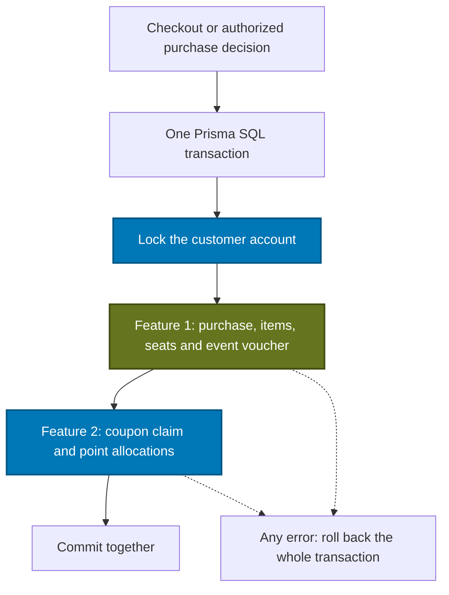

# Reward reservation, consumption and restoration — companion note

Updated: 1 November 2026, Asia/Jakarta. Day 2, subpart 4. Implemented on `feature-2` as an internal TypeScript service. It joins the caller's Prisma transaction and manages platform coupons, point balances and their exact purchase allocations. No new public write endpoint or checkout UI is introduced by this checkpoint.

## Transaction boundary



| Building block | What / why / how |
| --- | --- |
| Node.js and TypeScript | Execute the backend service; types describe pricing, selections, claim results and the transaction client. |
| Express / verified session | The future calling endpoint authenticates the actor and authorizes customer or owning-organizer actions. This internal helper does not replace those HTTP guards. |
| Prisma transaction client (`tx`) | Every purchase/reward query uses the same SQL transaction. The helper does not start or commit an independent transaction. |
| PostgreSQL on Supabase | Stores balances, claims and allocations. Row locks serialize competing operations for a customer; constraints remain the backstop. |
| React wallet | Already reads the resulting available/held/used/expired states. This batch adds backend behavior and does not change the existing logo/theme. |

A transaction is the all-or-nothing boundary. A lock determines which overlapping operation can proceed first. These are separate guarantees: grouping writes alone does not prevent both requests from checking the same old balance.

The helper verifies the actual PostgreSQL transaction ID across two statements. Passing an ordinary autocommit Prisma client is rejected before reward writes. This uses a public PostgreSQL function rather than Prisma's internal proxy properties. Use one customer and sequential helper calls per transaction, and acquire this customer lock before purchase/inventory locks in every integrating flow.

## What is implemented

Entry point: [customerRewards](https://github.com/wilisail/event-management-platform-pwdk/blob/feature-2/feature-2/server/rewards/operations.ts). Pure amount/allocation rules are in [redemption-rules.ts](https://github.com/wilisail/event-management-platform-pwdk/blob/feature-2/feature-2/server/rewards/redemption-rules.ts).

| Method | Purpose / result |
| --- | --- |
| `customerRewards(tx, customerId)` | Validate the customer, verify the shared SQL transaction and lock that customer's row until the transaction ends. The ID comes from trusted backend context. |
| `quote(pricing, selection)` | Calculate discounts from server-validated subtotal/voucher, recorded coupon value and requested points. Check ownership, expiry and sufficient points. It does not create a claim. |
| `reserveNewPurchase(input, createPurchase)` | Quote, invoke feature 1's creation callback in the same transaction, verify the stored purchase amounts, then reserve rewards. Supports immediate confirmation when a **new** purchase is Rp0. A replay with the same purchase ID returns its existing result without rerunning creation. |
| `reserve(purchaseId, selection)` | Attach rewards to an owned waiting-for-payment purchase before its payment deadline; verify its stored amounts. Existing matching claims return their recorded state. It cannot retrospectively add rewards to a completed purchase. |
| `consume(purchaseId)` | Require `DONE`; change `RESERVED` to `CONSUMED`, retaining allocations and without deducting points again. A matching repeated consumption is a no-op. |
| `restore(purchaseId)` | Require `REJECTED`, `EXPIRED` or `CANCELED`; return the original point allocations once and mark the claim `RESTORED`, releasing its coupon. A matching repeated restoration is a no-op. |

Results include purchase/redemption IDs, claim state, actual points/coupon discount and allocation IDs/amounts. `NONE` means the purchase uses no platform rewards; no empty redemption row is created. All financial inputs are nonnegative safe whole integers. PostgreSQL/Prisma use bigint internally; conversion to JSON-safe numbers is checked.

`RewardOperationError` exposes `status`, `code` and a safe message. Invalid amounts/UUIDs are 400; a noncustomer purchaser is 403; a missing/other-owner purchase is 404. Unavailable coupons/points, mismatched purchase snapshots, conflicting replays/states and reached payment deadlines are 409. Transaction/clock configuration errors are internal failures. A future HTTP adapter maps these errors only after the enclosing transaction has rolled back; unexpected SQL/connection details stay private.

## Discount calculation

The existing [UX default](ux-reference.md#2-points-platform-coupons-and-event-vouchers) is unchanged:

1. Feature 1 validates and applies its event voucher.
2. Apply the selected platform coupon, capped at the remaining price.
3. Apply requested points, capped at the remaining price after that coupon.

Only the needed points are spent. If the capped amount still exceeds the available points, checkout fails rather than silently spending an unintended balance. A selected coupon must belong to this customer, be issued/unexpired and have no active reserved/consumed claim. Recorded coupon value is used, regardless of a later issuance-setting change.

| Example | Amount |
| --- | ---: |
| Subtotal | Rp100,000 |
| Event voucher | Rp10,000 |
| Platform coupon | Rp25,000 |
| Requested points | 80,000 |
| Actual points needed | 65,000 |
| Final payable | Rp0 |

If sufficient points exist, this creates an immediately confirmed purchase and consumed claim. A coupon is a single-use reward; if its discount is clipped by the price cap, no leftover coupon balance is created. If an event voucher already covers everything, the otherwise-selected coupon and points are not consumed.

The reward service validates its part of the calculation; feature 1 remains responsible for deriving the event/ticket price and event-voucher eligibility from trusted records. Client-supplied prices are not authoritative.

## Points: exact earning batches

Eligible grants have `creditedAt <= now`, `expiresAt > now` and positive `remainingAmount`. The service locks them in expiry/UUID order and allocates the earliest-expiring points first.

Example: a purchase reserves 12,000 points from two valid 10,000-point grants:

| Grant | Before | Allocation | After reservation | After restoration |
| --- | ---: | ---: | ---: | ---: |
| Earlier expiry | 10,000 | 10,000 | 0 | 10,000 |
| Later expiry | 10,000 | 2,000 | 8,000 | 10,000 |

The redemption records 12,000 and two immutable allocations record the exact sources. Conditional updates prevent a negative remainder. Consumption changes claim state without another balance deduction. Restoration increments those original rows, checks their bounds and preserves their original expiry. It never issues replacement points with a fresh three-month lifetime.

An already-expired grant can have its original remaining points returned for correct history, while the wallet still excludes it from spendable points. The same applies to a restored but expired coupon. See the [wallet note](wallet-reference.md) for read-time availability.

## Locks, retries and time

| Concern | Implemented handling |
| --- | --- |
| Two purchases spending one balance | A row lock serializes operations for the same customer. Other customers can proceed independently. Conditional grant updates also check the available remainder. |
| Two claims on one coupon | The customer lock and active-claim query are backed by the existing partial unique index for `RESERVED`/`CONSUMED`. Coupon terms remain immutable; no coupon-update grant is added. |
| Same purchase repeated | One purchase ID/claim, matching recorded selection/pricing, unchanged allocations; creation callback is not rerun. Conflicting selections return a conflict. |
| Rejection and timeout both restoring | Both must use the shared customer-first transaction boundary. The first restore changes claim state; the next sees `RESTORED` and does not increment points again. |
| Payment deadline | A new waiting-payment reservation fails at or after the persisted payment deadline. The clock is sampled after acquiring the customer/purchase locks. |
| Reward expires while awaiting review | A valid reservation stays applied. Consumption does not re-deduct or re-check award expiry; restoration preserves the original expiry. |
| Partial failure | Throw through the outer transaction. Purchase/item/inventory/reward writes all roll back, including a failure after the first returned point allocation. |

Use a short caller transaction; `ReadCommitted` plus these locks is the tested setup. If the caller chooses an isolation level that can raise serialization/deadlock conflicts, it owns bounded retries of the **whole** transaction. Do not blindly retry an uncertain network/commit outcome.

The stable purchase ID is this service's replay key. Deduplicating separate HTTP submissions that generated different purchase IDs still belongs to feature 1's checkout/idempotency-key adapter. No automatic request-key mapping is added here.

## Integration shape

Illustrative checkout adapter; `writeFeature1Purchase` denotes feature 1's own implementation, not a provided export:

```ts
await prisma.$transaction(async tx => {
  const rewards = await customerRewards(tx, verifiedCustomerId)
  return rewards.reserveNewPurchase({
    purchaseId: stablePurchaseId,
    subtotal: validatedTicketSubtotal,
    voucherDiscount: validatedEventVoucherDiscount,
    pointsRequested,
    couponId,
  }, async quote => {
    await writeFeature1Purchase(tx, quote)
    // Same tx: owned purchase/items, seat and event-voucher changes.
    // Positive total: WAITING_FOR_PAYMENT with a persisted deadline.
    // Zero total: DONE with completedAt and no proof/payment deadline.
  })
}, { isolationLevel: 'ReadCommitted', timeout: 10000 })
```

For a decision/expiry operation, acquire `customerRewards(tx, purchaseCustomerId)` first, validate the permitted owned purchase transition and deadline, update purchase state/resources, then call `consume` or `restore` before commit. A future organizer endpoint must check that the signed-in organizer owns the event. A worker must enforce the relevant persisted deadline. Emails/file transfers stay outside the SQL transaction; the notification outbox is separate planned work.

The helper requires a terminal purchase state; it does **not** authorize which transition produced it. Supporting restoration for a terminal purchase does not introduce a new customer-cancellation or post-confirmation cancellation UI. The purchase state machine stays with the shared feature 1 transition engine.

Do not catch a failed helper and commit earlier checkout writes. Let the transaction abort, or explicitly roll back the complete attempt to a savepoint. Do not replace the direct helper call with HTTP to a separate backend: two HTTP requests do not share one PostgreSQL transaction.

Create a fresh helper for a new transaction or after rolling back past the point where its customer lock was acquired. In the combined backend, use the agreed Prisma 7.10.1 schema/client mapping and keep one transaction authority; separate standalone entry points do not synchronize independent databases or duplicate reward writers.

## Verification

`npm run db:verify:reward-operations` uses the existing Supabase backend role in one outer rollback transaction. It checks:

- Earliest-expiry allocation, coupon hold, actual purchase snapshots and matching/conflicting replays.
- Sufficient balance, ownership, customer role and exact payment deadline boundaries.
- Consumption/restoration once; original allocations, coupon release/reuse and immutable expiry.
- Immediate Rp0 confirmation, free orders, unused-reward caps and historical backfill rejection.
- Purchase/item/inventory/claim/allocation rollback after late failure, mismatched pricing and a failure partway through restoration.

`npm run db:verify:reward-races` is an opt-in check for a **separate loopback database** named `temuevent_reward_test`, using `temuevent_app`. It refuses the shared Supabase `DATABASE_URL` and requires explicit isolated settings. Actual multi-session tests need committed fixtures visible to both contenders, so these are committed only in the disposable test database.

The isolated PostgreSQL 17 test instance uses all four unchanged project migrations and the same backend-role policies. Six overlapping scenarios use separate PostgreSQL sessions: competing point spends, competing coupon claims, identical purchase retries, repeated restoration, repeated consumption and a failed reservation with another checkout waiting. The normal autocommit client is also rejected by the transaction-boundary guard. This is correctness testing, not a production load benchmark.

Supabase fixtures roll back; the isolated database is discarded with its test VM. No shared migration, credential, role grant or exposure setting changes for this batch.

Recorded result: TypeScript, all **96 application tests** and the production build passed. The eleven live Supabase scenarios and six isolated multi-session race scenarios passed. Original row fingerprints match: 2 users, 3 events, 4 ticket types and 30 purchases/items. No test reward records are retained in the shared database. The frontend/logo/theme are unchanged. These checks verify the reward core and test adapters; they do not claim a deployed evaluator application or completed feature 1 checkout integration.

## Current boundary and next work

| Area | Status |
| --- | --- |
| Feature 2 reward core | Reserve, consume, restore, calculation, replay protection and tests are implemented. |
| Feature 1 checkout / seats / event vouchers | Own implementation stays with feature 1. Production adapter and full combined-flow verification remain. Test checkout callbacks demonstrate the shared transaction boundary. |
| Organizer decision / purchase expiry | Still need their real authorized endpoints/worker and shared state transitions. They call this reward core rather than implement a second restoration process. |
| Feature 2 account | Real wallet/referral reads already show stored reward states. Profile/picture/password lifecycle is the next day's work. |
| Delivery | Evaluator deployment, trusted proxy/rate-limit configuration, CI/monitoring and complete browser/cross-feature regression remain on the release plan. |

## Learning checkpoint

1. Why is one transaction necessary even though each individual SQL update is atomic?
2. What does the customer row lock prevent that a balance check alone cannot?
3. Why record grant allocations rather than just subtract and later add a total?
4. Why must consumption avoid deducting reserved points again?
5. Why can restoring points still leave the spendable wallet balance at zero?
6. Why does an HTTP call to another backend break this SQL transaction boundary?
7. What does the helper's purchase-ID replay protection cover, and what still belongs to the checkout API?
8. Why do multi-session races require an isolated committed test dataset instead of one shared rollback transaction?

Course connections: TypeScript interfaces, service boundaries, Prisma transactions, SQL locks/constraints, validation and integer arithmetic, asynchronous races, error/rollback handling, secure ownership and unit/database tests.

Primary references: [PostgreSQL row locks](https://www.postgresql.org/docs/17/explicit-locking.html#LOCKING-ROWS), [transaction isolation](https://www.postgresql.org/docs/17/transaction-iso.html), [transaction IDs](https://www.postgresql.org/docs/17/functions-info.html#FUNCTIONS-PG-SNAPSHOT).
