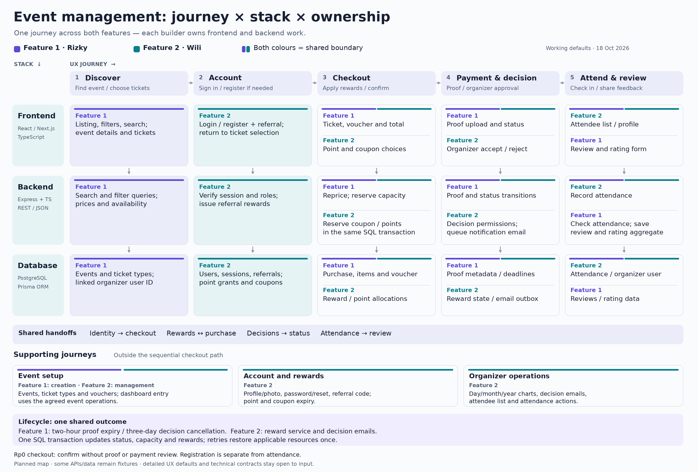

# Shared UX reference

[Full-size PNG](assets/ux-journey-stack-map.png) · [Editable SVG](assets/ux-journey-stack-map.svg)

[Project record](consistency.en.md) · [Technical reference](technical-reference.md) · [UI previews](../previews/README.md)

Updated: **18 October 2026**. Status: working defaults supplied by Wili, open to changes following input. The bold options are the current defaults; the alternatives describe the resulting changes to feature 1 and feature 2. This reference records planned behavior; implementation status is in the project record.

## Journey and stack map

Read each matrix **left to right for the UX journey** and **top to bottom for frontend, backend and database work**. Ownership labels identify the builder of that part of the flow. Both features include all three layers.

This is a planned responsibility map, not an implementation-completion checklist. Current previews use React/Next.js + TypeScript and the shared TemuEvent styling. The proposed backend is Express + TypeScript with REST/JSON; persistence is Prisma + PostgreSQL hosted on Supabase. Implementation status, field formats and service boundaries are in the [technical reference](technical-reference.md).

| Owner | Full-stack subfeatures |
| --- | --- |
| Feature 1 — Rizky | Event discovery/details/creation; purchasing and event promotions; payment-proof and transaction lifecycle; reviews and ratings. |
| Feature 2 — Wili | Authentication and authorization; referrals, points, platform coupons and profiles; organizer dashboard, decisions, statistics, attendee list and attendance. |

### Customer journey: discovery to checkout

| Stack layer ↓ / UX journey → | 1. Discover and choose tickets | 2. Sign in / register when needed | 3. Review discounts and confirm checkout |
| --- | --- | --- | --- |
| **Frontend — React + TypeScript** | **Feature 1:** responsive landing/list/detail pages, category/location filters, debounced search, ticket type/quantity selection and empty states. | **Feature 2:** login/register, optional referral code and return to retained ticket selection. **Feature 1:** preserves the selection and resumes checkout. See [choice 1](#1-login-before-completing-a-purchase). | **Feature 1:** voucher, coupon and point controls; IDR breakdown and purchase confirmation. **Feature 2:** supplies wallet/identity data. See [choice 2](#2-event-voucher-referral-coupon-and-points). |
| **Backend — Express + TypeScript** | **Feature 1:** event search/filter/detail queries and current availability. Public discovery does not require a session. | **Feature 2:** account/session verification, role middleware, immutable referral code and referral issuance. **Feature 1:** uses verified identity for purchases. | **Feature 1:** recalculates totals, checks capacity, creates purchase/items and reserves seats/event voucher. **Feature 2 reward service:** reserves eligible coupon/point batches inside the same SQL transaction. A zero-payable registration goes directly to confirmed; see [choice 3](#3-free-events-and-a-final-payable-amount-of-zero). |
| **Database — PostgreSQL through Prisma** | **Feature 1:** events and ticket types; organizer IDs link to feature 2 users. | **Feature 2:** users, sessions, referrals, point grants and platform coupons. Registration and referral awards commit together. | **Feature 1:** transactions/items, historical prices and actual deductions, capacity/voucher reservations. **Feature 2:** reward redemptions and point allocations linked to that transaction. |

The two-hour payment-proof clock starts after authenticated purchase creation, not while browsing or signing in. A zero-payable registration skips the payment-proof and payment-review stages below and still needs attendance before reviewing.

### Customer journey: payment to review

| Stack layer ↓ / UX journey → | 4. Upload proof and track payment | 5. Receive organizer decision | 6. Attend the event | 7. Review and view organizer ratings |
| --- | --- | --- | --- | --- |
| **Frontend — React + TypeScript** | **Feature 1:** payment instructions, protected proof upload, two-hour countdown, confirmation-stage deadline and transaction status. | **Feature 2:** organizer proof viewer and accept/reject confirmation. **Feature 1:** customer sees the resulting status. **Feature 2:** wallet reflects applicable reward changes. | **Feature 2:** organizer attendee list with name, ticket quantity, total paid and manual attendance action. | **Feature 1:** eligible review/rating form and review data. **Feature 2:** organizer profile displays the supplied ratings/reviews. |
| **Backend — Express + TypeScript** | **Feature 1:** authorizes proof upload, stores its reference and advances the purchase to waiting for confirmation. Server timestamps drive both countdowns; see [choice 4](#4-three-day-organizer-decision-window). | **Feature 2:** verifies organizer ownership and calls the **feature 1 purchase-transition service**. The shared SQL operation confirms or rejects the purchase and consumes/restores applicable resources. **Feature 2:** records an email notification for delivery after commit. | **Feature 2:** reads confirmed purchases and records attendance through an organizer-authorized action. Confirmed registration alone does not mark attendance. | **Feature 1:** checks the feature 2 attendance record before accepting a review and calculates rating aggregates. See [choice 5](#5-attendance-before-reviewing). |
| **Database — PostgreSQL through Prisma** | **Feature 1:** payment-proof metadata, purchase status, payment deadline and decision deadline. The private file is in file storage, outside SQL. | **Feature 1:** purchase state and capacity/event-voucher changes. **Feature 2:** coupon/point reservation state and email-outbox event. Related writes use one database transaction. | **Feature 1:** completed purchases/items supply the confirmed attendee list. **Feature 2:** attendance links customer, event and qualifying purchase. | **Feature 1:** review records link event/customer; aggregates feed the public organizer profile. **Feature 2:** supplies organizer identity/profile and attendance eligibility. |

### Organizer and account journeys around the main path

These flows can happen before or alongside a purchase; they are not extra sequential checkout steps.

| UX journey / owner | Frontend | Backend | Database / external service |
| --- | --- | --- | --- |
| **Create events and promotions — feature 1** | Event form: description, dates, location/category, image, free/paid pricing, capacity and applicable ticket types; event voucher validity. | Feature 1 validates and writes event/ticket/voucher data using feature 2 organizer identity and permissions. | Feature 1 events, ticket types and event vouchers; organizer foreign key to feature 2 users; image storage if used. |
| **Manage own events — feature 2 dashboard; feature 1 event operations** | Feature 2 lists the organizer's events and provides management/edit entry points. Feature 1 supplies the event form/operations; form placement or reuse remains open to input. | Feature 2 restricts dashboard access to the organizer's records; event changes use the agreed feature 1 operation rather than a second conflicting event model. | Feature 1 event records, linked to feature 2 organizer identity. |
| **Manage account and profile — feature 2** | Profile editing/photo upload, password change, forgotten-password and reset screens. | Feature 2 validates account changes, authorizes uploads, hashes passwords and verifies expiring reset tokens. | Feature 2 users, sessions/reset-token records; image storage and password-reset email service. |
| **View referral rewards and expiry — feature 2** | Immutable referral-code display; point batches, available/reserved coupons and expiry explanations. Checkout displays this data in feature 1. | Feature 2 awards the referred user a coupon and the referrer 10,000 points; calculates spendable rewards with three-month expiry. Feature 1 spends/restores through the shared reward service. | Feature 2 referrals, point grants, coupons, redemptions and allocations. Restored rewards retain their original expiry under the technical working default. |
| **View statistics — feature 2** | Organizer charts/reports by day, month and year. | Feature 2 aggregates owned-event/purchase data. Default revenue uses completed purchases' final paid amounts and completion time. | Feature 1 events, purchase items, totals and completion timestamps. Free registrations contribute attendance, with Rp0 revenue. |
| **See expiry/cancellation and restored resources — feature 1 lifecycle; feature 2 rewards/dashboard** | Feature 1 shows expired/canceled status; feature 2 shows the same status and eligible reward availability. | Feature 1 scheduled processing applies the two-hour/three-day rules and shared transitions. Feature 2 reward service restores recorded allocations once. Persisted deadlines and request-time guards enforce the same rules if a job is delayed. | One SQL transaction updates purchase, capacity, event-voucher and reward records. A restart must not lose deadlines or cause duplicate restoration. |

### Cross-feature contracts

| Shared information / operation | Supplied by | Used by |
| --- | --- | --- |
| Verified customer/organizer identity and ownership checks | Feature 2 authentication and authorization | Feature 1 event creation, checkout, proof access and reviews; feature 2 organizer operations |
| Available coupons/points and reserve/consume/restore helpers | Feature 2 reward service | Feature 1 purchase creation and lifecycle, within the caller's SQL transaction |
| Owned events, purchases/items, proofs, totals, statuses and deadlines | Feature 1 event/purchase services | Feature 2 event management, decision queue, attendee queries, statistics and emails |
| Accept/reject action | Feature 2 organizer endpoint calls feature 1 transition service | Feature 1 customer transaction status; feature 2 dashboard, rewards and notifications |
| Attendance eligibility | Feature 2 attendance records | Feature 1 review authorization |
| Reviews and rating aggregates | Feature 1 review service | Feature 2 public organizer profile |

Database ownership follows these subfeatures. Wili's hosting, seed-data and migration coordination does not transfer feature 1's database queries or business logic to feature 2. Visual direction follows feature 1; each builder implements their own screens using that shared direction. Standalone demonstrations and the integrated application's authoritative dataset are described in the [technical reference](technical-reference.md#8-integration-migrations-and-checks).

The map follows the supplied PRD and the working defaults below. Website references explain those defaults where applicable; they do not specify our frontend/backend ownership. Changes to a shared boundary update this map and the technical reference; implementation choices inside one feature remain with its builder.

## 1. Login before completing a purchase

- **A — Default: browse and choose tickets, then login/register before creating the checkout transaction. After login, return to the same event, ticket types and quantities.**
- B — Alternative: require login before ticket selection.

**PRD source:** Feature 2 → User Authentication and Authorization → Account Creation and Role-Based Access: customers need an account to attend; protected pages and backend permissions are required. Feature 1 → Event Transaction → Purchasing supplies the purchase flow.

**Website basis:** [Ticketmaster buying tips][tm-login] recommend signing in before purchase. [Live Nation Asia's FAQ][ln] explains that its event link can lead to a separate ticket-selling website, where the buyer needs that website's account. Our platform uses one account for both features; no second website/account is needed. These references support authenticated purchasing. They do not prescribe the exact point at which our login screen appears.

**Default UX:** retain the chosen event, ticket types and quantities through login instead of sending the customer back to the home page. Recheck price, capacity and reward eligibility after login. Start the two-hour proof deadline only after the authenticated checkout transaction is created.

| Area | With default A | If changed to B |
| --- | --- | --- |
| Feature 1 | Browsing/ticket selection stays available; checkout resumes the retained selection after login. | The login prompt moves to the ticket-selection entry; selection starts after login. |
| Feature 2 | Login/register returns the customer to the retained checkout selection. | Login/register returns the customer to the event's ticket-selection page. |

## 2. Event voucher, referral coupon and points

- **A — Default: allow one eligible event voucher, one eligible platform coupon and available points in the same purchase. Show each deduction separately.**
- B — Alternative: use either an event voucher or a platform coupon, plus available points.

**PRD source:** Feature 1 → Event Discovery, Details, Creation, and Promotion → Promotions requires organizer event vouchers; Feature 1 → Event Transaction → Point Usage allows points to reduce payment. Feature 2 → Referral System, Profile, and Prizes → Referral Rewards gives a coupon to a referred registrant. The Clues section distinguishes event-specific organizer vouchers from platform coupons usable across events. The PRD requires all three capabilities; it does not specify whether they can be combined.

**Website basis:** [Eventbrite promo entry][eb-promo] shows code entry and updated discounted prices. [Ticketmaster promo guidance][tm-promo] shows promo-code entry during checkout. These pages establish the promotion interaction, but do not establish our exact combination of event voucher + referral coupon + points.

**Default UX:** apply the event voucher, then the platform coupon, then points against the remaining amount. Each deduction is capped at the remaining payable amount; total cannot be negative. Only the points needed are spent. The backend calculates the amount and the customer sees the breakdown before confirmation. Default A supports the three PRD capabilities together; it remains open to change because combination is not prescribed by the PRD or the cited websites. Coupon face value remains unspecified by the PRD.

| Area | With default A | If changed to B |
| --- | --- | --- |
| Feature 1 | Checkout exposes all three deductions; purchase records retain what was used for accurate restoration. | Selecting a voucher makes the coupon unavailable, or vice versa; totals and explanations change. |
| Feature 2 | Wallet supplies eligible points/coupons; organizer rejection uses the same recorded deductions for restoration. | Wallet balances stay the same, but checkout eligibility/message and rejection tests follow the single-discount restriction. |

## 3. Free events and a final payable amount of zero

- **A — Default: no payment proof; create a confirmed registration with transaction status `done`, deduct capacity, and show it in the organizer's attendee list.**
- B — Alternative: no payment proof, but wait for organizer acceptance/rejection before confirming registration.

**PRD source:** Feature 1 → Event Discovery, Details, Creation, and Promotion → Pricing explicitly permits free and paid events. Feature 1 → Event Transaction → Point Usage permits payment reductions, and Transaction Statuses includes `done`. Feature 2 → Event Management Dashboard → Attendee List requires attendee name, ticket quantity and total paid. The PRD does not explicitly define the approval path for a free or fully discounted order.

**Website basis:** [Eventbrite's manual-order documentation][eb-free] supports free/no-payment orders and registration confirmation. Its [promotion documentation][eb-create-promo] also describes a full discount making a ticket free. This supports a no-payment registration pattern; our mapping to `done` is the working default, rather than a quoted PRD rule.

**Default UX:** still require login, create a real registration/purchase record, account for capacity and any rewards used, and display Rp0 as the amount paid. Skip payment instructions, proof upload and payment-review timers. Feature 2 shows the registration and can send confirmation. A registered attendee is not automatically marked as having attended; check-in remains separate under choice 5.

| Area | With default A | If changed to B |
| --- | --- | --- |
| Feature 1 | Customer sees registration confirmed immediately, with no proof-upload step. | Customer sees a pending organizer-decision state despite no payment being due. |
| Feature 2 | Registration appears in the confirmed attendee list without a payment-review task. | Dashboard needs a no-payment approval queue and acceptance/rejection emails. For this no-proof path, the proposed three-day clock starts at registration; rejection/cancellation restores capacity and applicable rewards. |

## 4. Three-day organizer decision window

- **A — Default: for purchases requiring payment proof, count three days (72 hours) from successful proof upload and entry into `waiting for admin confirmation`.**
- B — Alternative: count three days from the original checkout transaction.

**PRD source:** Feature 1 → Event Transaction → Payment Proof gives two hours after checkout to upload proof. Automatic Status Changes requires expiry without proof in two hours, and cancellation if the organizer does not accept/reject within three days. Feature 2 → Event Management Dashboard → Transaction Management supplies organizer accept/reject actions. The PRD specifies the durations but does not precisely identify the start of the three-day window.

**Website basis:** [LOKET order data][loket-orders] illustrates organizer purchase/payment-status visibility. [Live Nation Asia][ln] describes timed ticket holds and capacity becoming available again after an incomplete purchase. Neither source establishes this project's manual-proof three-day approval rule.

**Default UX:** after checkout, the customer sees a two-hour proof deadline. After a successful proof upload, both customer and organizer see a decision deadline 72 hours later. No decision by that deadline changes the purchase to `canceled`; missing proof by the first deadline changes it to `expired`. Rejection/expiry/cancellation restores applicable resources once. The same backend deadlines drive both interfaces.

| Area | With default A | If changed to B |
| --- | --- | --- |
| Feature 1 | Customer confirmation-stage deadline starts after proof upload; expiry/cancellation processing uses that timestamp. | Customer deadline starts earlier; cancellation processing uses checkout time. |
| Feature 2 | Organizer receives the full three-day review period once proof is available. | Remaining review time is reduced by the customer's upload delay; the dashboard deadline and reminders must match. |

## 5. Attendance before reviewing

- **A — Default: the organizer finds the attendee by name/order and marks attendance in the attendee list. Feature 1 permits a review only after that attendance record exists.**
- B — Alternative: the organizer verifies a ticket code or scans its QR/barcode to record attendance.

**PRD source:** Feature 1 → Event Reviews and Ratings → Reviews permits customer reviews only after attending the event. Feature 2 → Event Management Dashboard → Attendee List requires the organizer attendee list. The PRD requires attendance-based eligibility but does not require a scanner.

**Website basis:** [Eventbrite computer check-in][eb-checkin] supports finding a name/order and marking it checked in. [LOKET check-in][loket-checkin] supports manual name lookup and barcode scanning. Default A follows the documented manual check-in path.

**Default UX:** feature 2 records which customer attended which event through an organizer-authorized action. Feature 1 checks that record on the backend before accepting a review. Confirmed payment/registration alone does not mark attendance. Organizer profiles display ratings supplied by the feature 1 review data.

| Area | With default A | If changed to B |
| --- | --- | --- |
| Feature 1 | Review availability follows the shared attendance record; ticket display needs no scan code. | Ticket display must expose a verifiable code if scanning is chosen. The review UX can stay the same when the attendance response format is unchanged. |
| Feature 2 | Attendee list has a manual attendance action. | Add code entry/scanning and duplicate-check-in feedback; write the same attendance record. |

## Change record

| Date | Record |
| --- | --- |
| 2026-10-18 | Options A recorded as working defaults, open to changes following input. PRD requirements and inferred behavior are identified above. |
| 2026-10-18 | Added journey/stack matrices, organizer/account flows and cross-feature data/operation ownership; linked the technical reference. |
| 2026-10-18 | Added a colour-coded journey/stack flow diagram at the top, with full-size PNG and editable SVG assets. Existing UX defaults are unchanged. |

For a revision, record the changed option, reason, date and affected customer/organizer flow. Update both features' interface expectations and relevant tests together. Decisions internal to one feature remain with its builder.

## Official references

- [Ticketmaster buying tips][tm-login]
- [Ticketmaster promo codes][tm-promo]
- [Eventbrite promo-code entry][eb-promo]
- [Eventbrite promotion setup][eb-create-promo]
- [Eventbrite free/no-payment orders][eb-free]
- [Eventbrite computer check-in][eb-checkin]
- [Live Nation Asia FAQ][ln]
- [LOKET organizer order data][loket-orders]
- [LOKET check-in][loket-checkin]

Checked 18 October 2026. Official search excerpts were used where Eventbrite direct pages returned rate limits.

[tm-login]: https://help.ticketmaster.com/hc/en-us/articles/9781745448977
[tm-promo]: https://help.ticketmaster.com/hc/en-us/articles/9702471922449-How-do-I-apply-passcodes-discount-codes-and-promo-codes
[eb-promo]: https://www.eventbrite.com/help/en-gb/articles/254822/how-to-apply-a-discount-or-access-code-to-your-order/
[eb-create-promo]: https://www.eventbrite.com/help/en-us/articles/362532/how-to-set-up-discount-codes-for-one-or-multiple-events/
[eb-free]: https://www.eventbrite.com/help/en-us/articles/874192/how-to-add-attendees-manually/
[eb-checkin]: https://www.eventbrite.com/help/en-hk/articles/126937/how-to-use-a-laptop-to-check-in-attendees-at-your-event/
[ln]: https://www.livenation.asia/faq
[loket-orders]: https://docs.loket.com/panduan/data-pemesanan
[loket-checkin]: https://docs.loket.com/panduan/check-in-pengunjung
