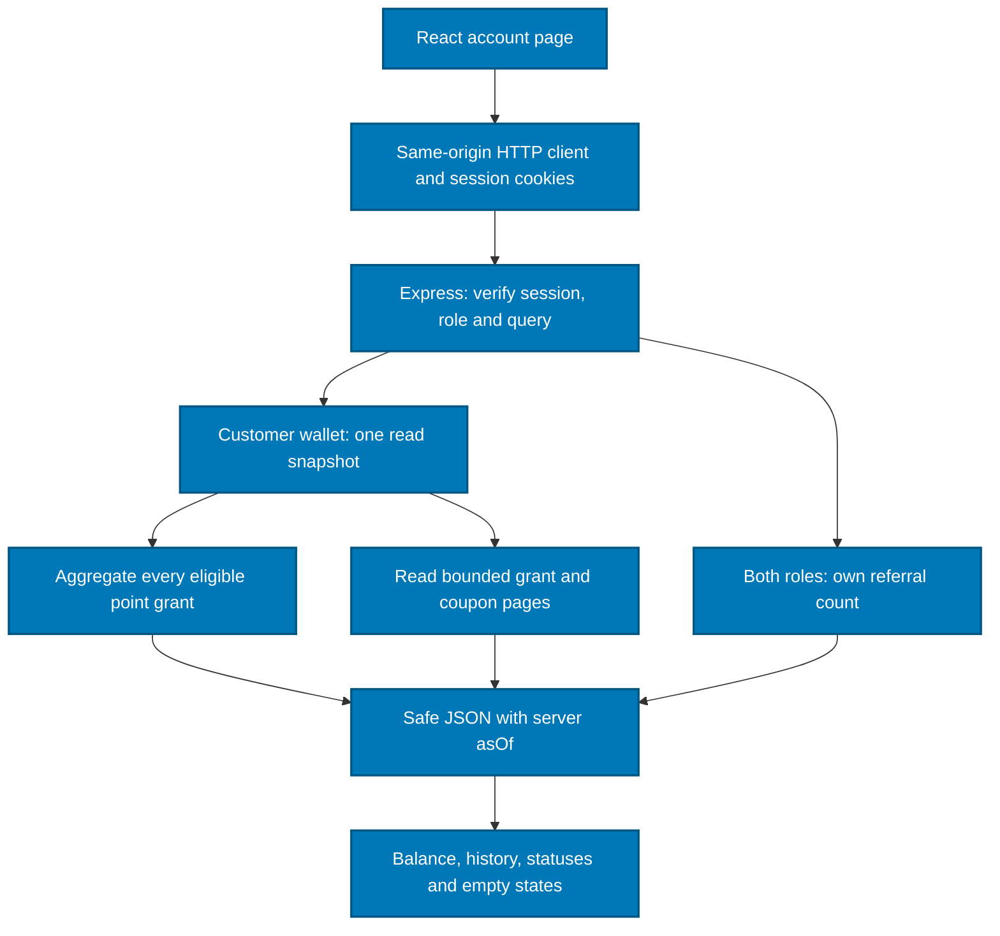

# Authenticated wallet and referral reads — companion note

Updated: 1 November 2026, Asia/Jakarta. Day 2, subpart 3. Implemented on `feature-2`: the account page reads real point grants, platform coupons and referral counts belonging to the signed-in account. The separate `/preview` and `/api/demo/*` routes remain fixtures.

## How the layers connect

| Building block | What it does here | Why it is separate |
| --- | --- | --- |
| React, running in the existing Next.js frontend | Displays the wallet and referral tabs, loading/errors, pagination and refresh controls. | The browser presents information; it cannot choose its owner or manufacture the balance. |
| Auth client and Next rewrite | Sends `/api/me/rewards` or `/api/me/referral` to Express on the same browser origin. Existing session-refresh handling is reused. | Database passwords stay out of browser code. HTTP cookies and a database connection are different credentials. |
| Express and authorization middleware | Verifies the signed session against the session/user records, checks the role and validates query fields. | A hidden tab or a supplied `userId` is not authorization. The actor comes from the verified session. |
| Prisma repository | Runs typed, owner-filtered queries and converts selected database fields into the response. | Prisma is database access code, not the place where the database is hosted. |
| PostgreSQL on Supabase | Stores the original grants, coupons, referral links and purchase claims; enforces their constraints. | Supabase hosts the PostgreSQL database. This implementation uses the existing private backend connection, not Supabase Auth or the browser Data API. |

No dependency, schema, migration, credential, grant or Data API exposure changes are required for this batch. The original TemuEvent logo, CSS/theme and feature 1 source are reused unchanged.

## Reading a balance

For each point grant, include `remainingAmount` only when:

- `creditedAt <= asOf`;
- `expiresAt > asOf`.

The stored `remainingAmount` already excludes points reserved by purchases. Do not subtract allocations a second time. The next subpart implements the service that changes this amount together with purchase allocations.

Example at the API's recorded time:

| Grant | Original award | Remaining | State | Contribution |
| --- | ---: | ---: | --- | ---: |
| A | 10,000 | 6,000 | Valid; 4,000 already allocated | 6,000 |
| B | 10,000 | 10,000 | Valid | 10,000 |
| C | 10,000 | 10,000 | Expired at this instant | 0 |
| D | 10,000 | 10,000 | Credit time is still in the future | 0 |
| E | 10,000 | 0 | No unallocated remainder | 0 |
| **Available balance** | | | | **16,000** |

The sum covers **all** eligible rows, even when a history page shows only two or ten rows. An empty wallet returns a real zero and empty lists. A storage failure returns a controlled error; it does not substitute zero or sample data.

Each reward retains its recorded terms. Three-calendar-month arithmetic and UTC month-end clamping are implemented at issuance, as explained in the [signup note](referral-registration-reference.md). Reads compare those stored instants; they do not extend expiry. Jakarta time is only the display format. The exact expiry instant is excluded.

Expiry does not require editing or deleting an award: the next read naturally excludes it. This is different from the required purchase-expiry worker, which must change a transaction and restore its reserved resources.

## Coupon states

| State | Meaning |
| --- | --- |
| `USED` | A `CONSUMED` redemption exists. |
| `RESERVED` | A purchase holds it through a `RESERVED` redemption. It is not available to another purchase. |
| `PENDING` | No active claim; its issue time is still in the future. |
| `EXPIRED` | No active claim; its expiry is at or before `asOf`. |
| `AVAILABLE` | Issued, unexpired, and no reserved/consumed redemption. |

Restored claims do not block reuse, but an already-expired coupon remains expired. An active claim is shown as held/used even after the coupon's original expiry; this is history, not permission to spend it again. The API uses each coupon's recorded `discountValue`, not the current issuance setting or the old prototype amount.

The backend role cannot edit issued coupon terms. The live test verifies expiry by moving its private test clock, without changing those permissions or altering an award.

## Endpoints and ownership

| Endpoint | Access | Result |
| --- | --- | --- |
| `GET /api/me/referral` | Signed-in customer or organizer | Own immutable code, number of accounts registered using it, 10,000-point award rule and three-month validity. No invitee names/emails. |
| `GET /api/me/rewards` | Signed-in customer | Own all-row balance, available coupon count, and paginated grant/coupon history. |

Wallet query fields are `pointPage`, `couponPage` and `pageSize`. Defaults are 1, 1 and 10. Pages must be 1–1000; page size 1–50. History has stable timestamp/UUID ordering. Unknown fields, repeated parameters, caller-selected owners or a caller-selected clock are rejected. The referral endpoint accepts no query fields. Replies inherit `Cache-Control: no-store` from authentication middleware.

`AccountWalletView` is distinct from the fixture `WalletView`. Its `pointGrants` and `coupons` are `PageView` objects, not demo arrays. Existing demo consumers stay unchanged. The new contract lives in [feature 2 types](https://github.com/wilisail/event-management-platform-pwdk/blob/feature-2/feature-2/contracts/types.ts).

The wallet repository opens one short `RepeatableRead` transaction for its aggregate, counts and selected history. They see one PostgreSQL snapshot and share one application `asOf`. Several Prisma calls inside that transaction still use one connection. This avoids contradictory pieces of a response during an overlapping change; it does **not** reserve rewards or prevent a later purchase from changing the balance.

Page-number pagination matches the existing project components and is bounded for this learning project. Cursor pagination would be preferable for a large, frequently changing history; it is not a new project requirement. Read snapshots and ordinary SQL constraints are sufficient here; Redis or a separate wallet platform is unnecessary.

## Frontend behavior

`/account` keeps its existing profile tab, referral-code display/copy, customer/organizer navigation and theme. The referral tab now shows the real count and award explanation. The customer's points/coupons tab shows real amounts, per-award expiry, coupon status, history pages and useful empty states.

Reads reuse the existing authenticated client, including coordinated refresh and 401 handling. Abandoned requests are aborted. Results are keyed by account, route/pages and request version so an old response is not displayed for a different account or page. Errors offer retry and never display fixture rewards as real.

The visible tab refreshes every 60 seconds and when returning to it; a manual refresh is also provided. The page displays the API's update time in WIB. The display is an informational snapshot and may change before purchase. Checkout must revalidate and atomically reserve the actual rewards; browser timers or a previously displayed balance do not authorize spending.

## Effect on feature 1 and feature 2

| Area | Current behavior / next boundary |
| --- | --- |
| Feature 2 account | Real wallet and referral counts are implemented. Profile writes, picture/password lifecycle and other dashboard operations remain on the completion plan. |
| Feature 1 checkout | Can consume the authenticated wallet contract after the agreed session/routing handoff is connected. Use `AVAILABLE` coupons, recorded values/expiry and the summary balance. A combined production `/api/checkout-context` is not implemented in this batch. |
| Purchase reward operations | Reserve/consume/restore with original allocations and once-only restoration are the next subpart. Displaying a `RESERVED` state here does not mean that write service is finished. |
| Organizer role | Own referral summary remains accessible; spending/customer-wallet access remains customer-only, matching the existing split. |
| Event vouchers | Remain feature 1's event-specific promotions, separate from these platform coupons. |

## Verification and scope

Unit/API checks cover owner identity, demo/forged/revoked sessions, customer/organizer roles, bounded queries, caller-selected owner/time rejection, sanitized storage failures, exact credit/expiry boundaries, restored coupon states and safe bigint-to-JSON conversion.

`npm run db:verify:wallet` runs real registration → login → wallet/referral HTTP requests through Express, Prisma and the existing Supabase backend role. It checks correct recipients and stored coupon value, an empty account, all-page totals, held/spent/expired/future points, available/reserved/used/restored/expired/future coupons, and no invitee/private relationship fields. The test changes a private clock for immutable coupon expiry; it never broadens grants. It rolls back accounts, sessions, purchases, claims and rewards.

The verifier uses one outer repeatable-read transaction and passes that connection to the repositories. It verifies real query/HTTP behavior, not multi-connection concurrency or completed checkout writes. Browser password submission and actual multiple-tab session behavior remain manual release checks. Temporary visual QA uses safe, disposable database snapshots rather than bypassing the real account's sign-in guard.

At this checkpoint, TypeScript, all **91 application tests** and the production build passed. Live wallet verification passed with all fixtures rolled back. The actual auth client also passed real wallet/referral reads, role denial, query rejection and logout through the HTTPS Next proxy into the QA Express/Prisma/database service. The production component preview rendered the 10,000-point balance, recorded Rp25,000 coupon and referral count from disposable database records, using the unchanged logo/theme. The temporary QA page is removed before the final build and is not an evaluator deployment.

After QA shutdown, the original user/event/ticket/purchase row fingerprints are unchanged: 2 users, 3 events, 4 ticket types and 30 purchases/items. The QA proxy also surfaced the existing forwarded-IP/rate-limit configuration check. The application keeps its current restrictive proxy setting; deployment must configure the actual trusted proxy/source-IP chain and verify rate limiting, as already recorded in the release plan. This batch does not guess or broaden that trust setting.

## Learning checkpoint

Explain without cue notes:

1. Where are the data hosted, and what does Prisma do between Express and PostgreSQL?
2. Why must the API derive the user ID from the verified session?
3. Why can the history show two rows while the balance includes five?
4. Why is no cron job needed to stop an expired point grant contributing to this read?
5. Why does one read snapshot still not reserve a coupon for checkout?
6. Why is a database failure different from an empty wallet?
7. Why can a restored coupon still be expired, and why do we preserve its original expiry?

Course connections: React hooks/network state; REST/JSON and Zod; authenticated ownership; Prisma filtering, aggregation and relations; SQL isolation; UTC/date boundaries; safe numeric serialization; API/database tests; error handling. The next subpart adds the shared write-side transaction and concurrency mechanics.

Primary references: [PostgreSQL transaction isolation](https://www.postgresql.org/docs/17/transaction-iso.html#XACT-REPEATABLE-READ), [Supabase with Prisma](https://supabase.com/docs/guides/database/prisma). The repository keeps its existing pinned Prisma 7.10.1 client and verified TLS connection.
